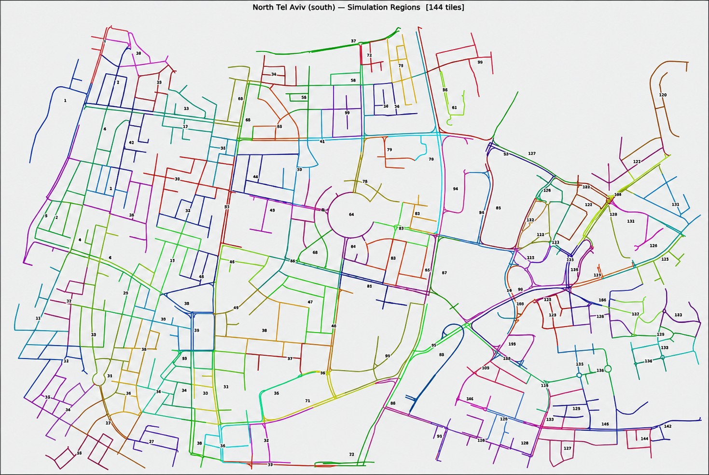
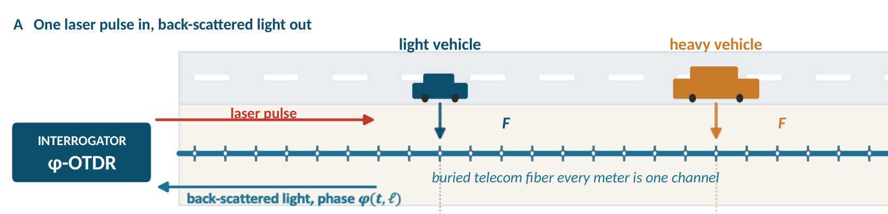
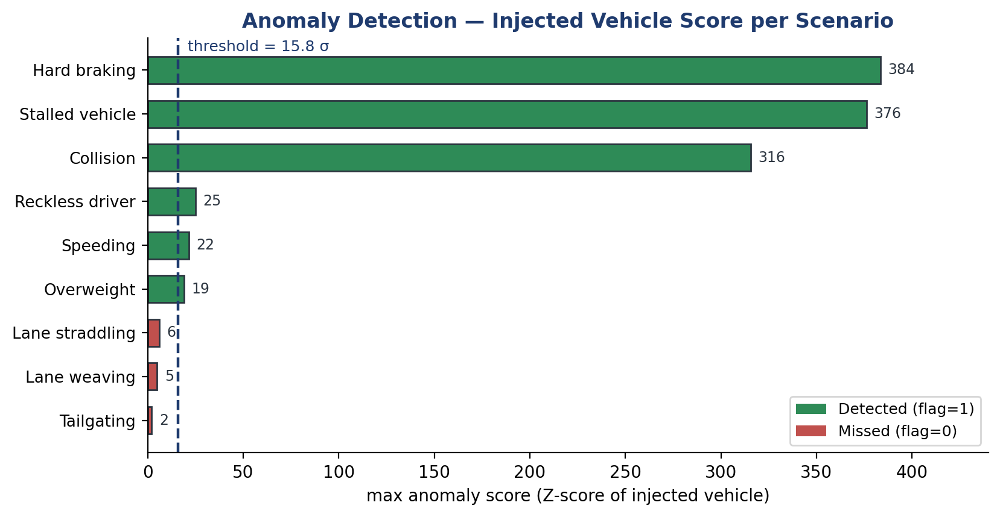

<p align="center">
  
</p>

<h1 align="center">DeepDAS</h1>

<p align="center"><b>Vehicle-level anomaly detection from fused fibre-optic (DAS), camera and GPS tracks with a deep ensemble</b><br>
Deep Learning course project, Tel Aviv University, 2026</p>

<p align="center">
  <a href="#quick-start">Quick start</a> ·
  <a href="INSTALL.md">Installation</a> ·
  <a href="models/">Models</a> ·
  <a href="docs/DATA_PACKAGE.md">Data</a> ·
  <a href="#key-results">Results</a> ·
  <a href="research/">Research studies</a> ·
  <a href="figures/">Figure gallery</a> ·
  <a href="report/">Report</a>
</p>

---

A buried telecom fibre can serve as a continuous traffic sensor. Distributed acoustic sensing (DAS) turns each metre of fibre into a vibration channel. In the earlier **SimStudio** project, DAS detections were fused with camera and GPS detections into vehicle tracks, and a hand-crafted Z-score model flagged anomalous drivers. That model missed three behaviours: lane weaving, lane straddling and tailgating.

**DeepDAS asks whether a deep model learned from the track sequences detects these behaviours, and at what false-alarm cost.**

- **What the system decides.** For each vehicle track it outputs one score and one decision: *anomalous* or *normal*.
- **What it does not do.** It is **not** a classifier that names the anomaly type. The nine anomaly types are used only to train it and to report recall per type.
- **Inputs.** The network sees only the fused tracks. No simulator-truth channel is an input. Truth is used to label vehicles and to verify that an injected anomaly really happened.

## Architecture

<p align="center">
  
</p>

1. **Windows.** A 6.4 s window of the fused track (14 channels × 64 bins of 0.1 s) passes four `Conv1d + GELU` layers and a linear projection to an 8-d code.
2. **Pooling.** The codes of all windows of a track are pooled into their mean and standard deviation (16 learned features).
3. **Head.** One explicit physical summary is added as the 17th input: the tailgating fraction φ<sub>u</sub>, the share of valid time with a leader at headway < 0.8 s and speed > 5 m/s. The head is an MLP, 17 → 16 → 1.
4. **Ensemble.** Five independently trained networks are standardised with frozen statistics and averaged. The decision threshold τ is frozen (1.973, the P99 of normal validation vehicles).

The figure is generated from the frozen checkpoints, and every shape is asserted against the code (`figures/scripts/make_architecture_figure.py`). There is no max-pooling and no dropout. Details: [docs/ARCHITECTURE.md](docs/ARCHITECTURE.md) · [model card](models/deepdas_ensemble_v1/MODEL_CARD.md).

## Two inference options (read before using the model)

The five networks were **trained with** φ<sub>u</sub> as the 17th head input. The repository supports two ways of running the same frozen weights, chosen explicitly on the command line:

| Option | Command flag | 17th head input | What it is |
|---|---|---|---|
| **Neutralized** | `--phi-mode neutralized` | held at 0 (standardised) | The same frozen weights with the extra summary switched off at inference. The 16 learned features are unchanged. This option was defined **after** the final test had been exposed, so its test numbers are post-hoc analysis. It is **not** a model trained without φ<sub>u</sub>. |
| **Active** | `--phi-mode active` | standardised φ<sub>u</sub> | The original hybrid model, exactly as trained, **selected, frozen and tested**. It is the reference for every published result. |

**Default.** If the flag is omitted, the code runs `active`. The documentation therefore always names the option explicitly. Full explanation: [docs/INFERENCE_MODES.md](docs/INFERENCE_MODES.md).

## Key results

**Common decided subset of the final test:** 101 verified anomalies and 1,008 normal vehicles. The test has 228 new simulated scenes in 8 held-out regions. Its plan, models, thresholds and evaluation code were frozen before simulation, and it was run once.

| | Hybrid, `active` | Neutralized (post hoc) | Supervised single model | SimStudio Z-score |
|---|---|---|---|---|
| Status on this test | frozen before the test | defined after the test was exposed | frozen before the test | frozen before the test |
| Macro recall, 9 types | **0.568** [0.49, 0.65] | 0.560 | 0.364 [0.30, 0.43] | 0.232 [0.22, 0.26] |
| ROC-AUC / AUPRC | **0.908 / 0.742** | 0.906 / 0.737 | 0.769 / 0.515 | 0.819 / 0.496 |
| Precision / F1 | 0.74 / 0.64 | 0.74 / 0.63 | 0.88 / 0.52 | 0.77 / 0.35 |
| False alarms, normal driving | 20 / 1,008 (2.0 %) | 20 / 1,008 | 5 / 1,008 (0.5 %) | 7 / 1,008 (0.7 %) |
| False alarms, legitimate stops < 10 s | 20 / 28 | 19 / 28 | 14 / 28 | 22 / 28 |
| Tailgating detected | 11 / 11 | 10 / 11 | 0 / 11 | 1 / 11 |

**Reading the table:**

- **Confidence intervals.** The brackets are 95 % bootstrap intervals over runs.
- **Z-score values.** The Z-score is shown on the same vehicles as the deep models. On its own, larger decided set (105 anomalies, 1,574 normals) it has ROC-AUC 0.783 and AUPRC 0.394.
- **Undecided vehicles.** The deep models give no decision for 700 of 1,708 normal vehicles (41 %): tracks that are too short or not usable. Undecided vehicles are never counted as normal.

<p align="center">
  
</p>

**What the curves show.**

- **The two options, compared.** The hybrid ensemble (solid blue) lies above both baselines over almost the whole operating range. The neutralized option (dashed) nearly coincides with it, so most of the ranking comes from the learned representation.
- **Operating points.** Open markers are the frozen operating points.
- **What not to read into it.** The curves rank vehicles. They are not a choice of threshold, and the test was not used to select anything.

<p align="center">
  
</p>

**Where the gain is.**

- **Gains over the Z-score.** Tailgating (11/11) and lane weaving (7/11) are behaviours the Z-score could not detect.
- **Detected by all detectors.** Stalls are detected by all of them (12/12).
- **Still weak.** Hard braking (at most 1/11 for every detector), speeding and overweight remain weak.
- **Where the single model is better.** On straddling and collision the single model does better.
- **Intervals.** Error bars are Wilson 95 % intervals. With 10–12 vehicles per type, they are wide.

**Development and validation.** These sets were used for design and selection, so they are not independent.

| | Hybrid, `active` | Neutralized |
|---|---|---|
| Development cases detected (9, one per type) | 8 / 9 | 7 / 9 (loses the tailgating case) |
| Validation: tailgating | 12 / 13 | 9 / 13 |
| Validation: macro recall / AP | 0.714 / 0.781 | 0.688 / 0.737 |

The neutralized numbers above were computed with the frozen standardisation and the frozen τ; nothing was re-estimated. Sources for every number: [REPORT_V2_NUMBER_SOURCES.md](research/08_tailgating_feature_intervention/tables/REPORT_V2_NUMBER_SOURCES.md).

**Main limitations** ([docs/LIMITATIONS.md](docs/LIMITATIONS.md)):

- many false alarms on legitimate short stops and on tailgating matched controls;
- weak recall on four types;
- decision coverage set by the tracker;
- simulation only, with a single real recording used qualitatively.

## Repository map

```text
DeepDAS/
├── README.md                 ← this page
├── INSTALL.md                ← installation, data package, checks, reproduction
├── src/deepdas/              ← the Python package
│   ├── ensemble/             ←   DeepDAS Ensemble v1 detector, scoring, --phi-mode option
│   ├── model/                ←   convolutional autoencoder (the encoder)
│   ├── train/                ←   supervised training of the ensemble seeds
│   ├── evaluation/           ←   development, validation and final-test evaluation
│   ├── data/                 ←   import, map matching, 14 channels, windows, splits
│   ├── baseline/             ←   SimStudio Z-score baseline wrapper
│   ├── batches/, sim/        ←   generators of the simulated anomaly sets
│   └── fp/, fp_anomaly_model/←   SimStudio simulator, tracker and Z-score model (unchanged)
├── scripts/                  ← entry points: checks, reproduction, scoring, training, import
├── models/                   ← frozen models (small: 2.3 MB in total)
│   ├── deepdas_ensemble_v1/  ←   5 checkpoints, thresholds, model card
│   └── baselines/            ←   supervised single model, SimStudio Z-score
├── results/                  ← published results, option `active` (development / validation / final_test)
├── results_phi_neutralized/  ← the same evaluations, option `neutralized` (post-hoc analysis)
├── research/                 ← eight studies, each: question → comparison → data → figure → conclusion
│   ├── 01_unsupervised_autoencoder/ … 07_targeted_data_study/
│   └── 08_tailgating_feature_intervention/
├── figures/                  ← figure gallery: architecture, development, validation, final test, post hoc
├── report/                   ← the 5-page report (PDF + LaTeX)
├── docs/                     ← architecture, data pipeline, protocol, limitations, background, data package
├── data/                     ← simulation plans and data description (processed data: separate package)
└── tests/                    ← unit and equivalence tests
```

| Folder | What is in it | Useful for |
|---|---|---|
| [`src/deepdas/`](src/) | Package code: data pipeline, encoder, ensemble detector, training, evaluation | developers |
| [`scripts/`](scripts/) | Command-line entry points with usage lines | anyone running the system |
| [`models/`](models/) | The frozen ensemble and the two baselines, with hashes | users, reviewers |
| [`results/`](results/) | Published tables and scores, kept apart by data role | readers checking a number |
| [`results_phi_neutralized/`](results_phi_neutralized/) | The neutralized-option outputs, every file stamped with its mode | reviewers of the φ<sub>u</sub> analysis |
| [`research/`](research/) | One page per study, with figures and reproduction steps | lecturers, researchers |
| [`figures/`](figures/) | All scientific figures with data and generating script | readers, report authors |
| [`report/`](report/) | The course report | lecturers |
| [`docs/`](docs/) | Technical documentation and project background | everyone |
| [`data/`](data/) | What data exists and how to obtain it | anyone reproducing results |
| [`tests/`](tests/) | `pytest` suite; most tests need the data package (expected results in `tests/README.md`) | developers |

The repository keeps the folder layout of the frozen release package (`DeepDAS_Release_v1.1_review`), so every code path is unchanged. [docs/REPOSITORY_MAP.md](docs/REPOSITORY_MAP.md) lists what was moved, added or left out.

## Quick start

These commands were tested in a fresh clone (Linux x86-64, Python 3.13, CPU). Requirements: Python ≥ 3.11 and no GPU. Memory, from the release documentation: about 2.5 GB for scoring, about 6 GB for the full verification with parallel workers.

```bash
# 1. environment (CPU build of PyTorch)
python3 -m venv .venv && . .venv/bin/activate
pip install --upgrade pip
pip install -r requirements.txt --extra-index-url https://download.pytorch.org/whl/cpu

# 2. check the installation and the frozen models (no data needed, a few seconds)
python scripts/check_models.py

# 3. after unpacking the data package (docs/DATA_PACKAGE.md) into the repository root:
python scripts/reproduce_development_cases.py outputs/dev_neutralized --phi-mode neutralized   # 7 / 9
python scripts/reproduce_development_cases.py outputs/dev_active      --phi-mode active        # 8 / 9, the published result
```

[INSTALL.md](INSTALL.md) covers full reproduction (validation and final test in both options), the tests, and how to verify that results match the published files byte for byte.

## Research and limitations

| # | Study | Question | Outcome |
|---|---|---|---|
| 01 | [Unsupervised autoencoder](research/01_unsupervised_autoencoder/) | Does a model of normal driving alone flag anomalies? | No (AUROC 0.60 vs 0.89 for the Z-score); its encoder is kept |
| 02 | [Supervised single model](research/02_supervised_single_model/) | Do a few labelled anomalies from other regions suffice? | 7/9 development cases; strongly seed-dependent → ensembles |
| 03 | [Tailgating data](research/03_tailgating_data/) | Is tailgating a data problem? | Validation tailgating recall 0.385 → 0.923 with varied, realised examples |
| 04 | [Stall diversity](research/04_stall_diversity/) | Do diverse stop modes fix the stalled case? | Yes → DeepDAS Ensemble v1 selected |
| 05 | [Legitimate stops](research/05_legitimate_stops/) | Can false alarms on short stops be removed? | Not within the other conditions → main limitation |
| 06 | [Weak-type diagnosis](research/06_weak_type_diagnosis/) | Where are the weak types lost? | After the encoder: in the head and its few examples |
| 07 | [Targeted data (W1/W2)](research/07_targeted_data_study/) | Does targeted data fix the weak types? | Weak-type recall 0.35 → 0.71 / 0.74 on validation, but the stop limit fails → not adopted |
| 08 | [Tailgating-feature intervention](research/08_tailgating_feature_intervention/) | How much does the frozen model depend on φ<sub>u</sub>? | One development case (tailgating); most test tailgaters stay detected without it |

**What these studies cannot show.**

- **The final test.** It is independent only for the three detectors frozen before it.
- **W1/W2 and the neutralized option.** Both were defined after the test was exposed.
- **A model trained without φ<sub>u</sub>.** No model was trained without φ<sub>u</sub> on the final training data, so the separate contributions of the feature and of the data are not identified ([study 08](research/08_tailgating_feature_intervention/)).

## Background: the SimStudio fibre-sensing project

DeepDAS builds on **SimStudio** (Final Project No. 3221, Tel Aviv University: Noa Sapir and Nitai Dobrecki, supervised by Khen Cohen). That project built:

- a desktop simulator of North Tel Aviv traffic;
- DAS, camera and GPS sensor models;
- a Kalman tracker that fuses them into vehicle tracks;
- the Z-score anomaly model.

DeepDAS reuses the simulator and tracker unchanged and replaces the hand-crafted detector with a learned one.

<table>
<tr>
<td width="50%"></td>
<td width="50%"><br><br></td>
</tr>
<tr>
<td><sub>North Tel Aviv road network (OpenStreetMap) divided into simulation regions.</sub></td>
<td><sub><b>Top:</b> one laser pulse in, back-scattered light out; every metre of fibre is a channel. <b>Bottom:</b> the SimStudio Z-score detected 6 of 9 original anomaly scenarios and missed straddling, weaving and tailgating.</sub></td>
</tr>
</table>

**Klausner Street, the one real recording (a city bus at a bus stop).**

- The SimStudio Z-score flagged it (max |z| = 27.5).
- The DeepDAS stage-1 autoencoder did not.
- The final DeepDAS ensemble, run on it by inference only, raises an **ALARM** in both options (s<sub>u</sub> = 4.53 / 4.55 > τ = 1.973).

The track is unlabelled, so this is a qualitative observation, not an evaluation ([Klausner experiment](models/deepdas_ensemble_v1/experiment_klausner/)).

What each project contributed, the physics, the anomaly model and the Klausner results with all figures: [docs/BACKGROUND_SIMSTUDIO.md](docs/BACKGROUND_SIMSTUDIO.md).

## Status and credits

- **Team.** Noa Sapir, Asaf Zini, Neta Shevo. The contribution of each member is to be completed by the authors.
- **Missing before submission.** The items still missing are listed in [MISSING_BEFORE_SUBMISSION.md](MISSING_BEFORE_SUBMISSION.md).
- **License.** No license has been chosen for this repository yet. Until one is added, all rights are reserved by the authors.
- **Third-party material.** Credits and attributions are in [CREDITS.md](CREDITS.md).
