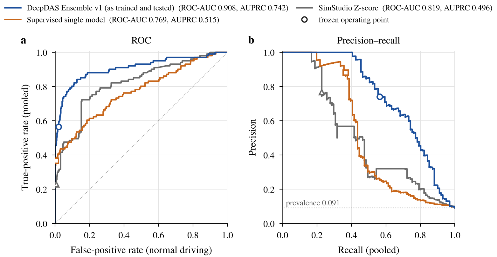
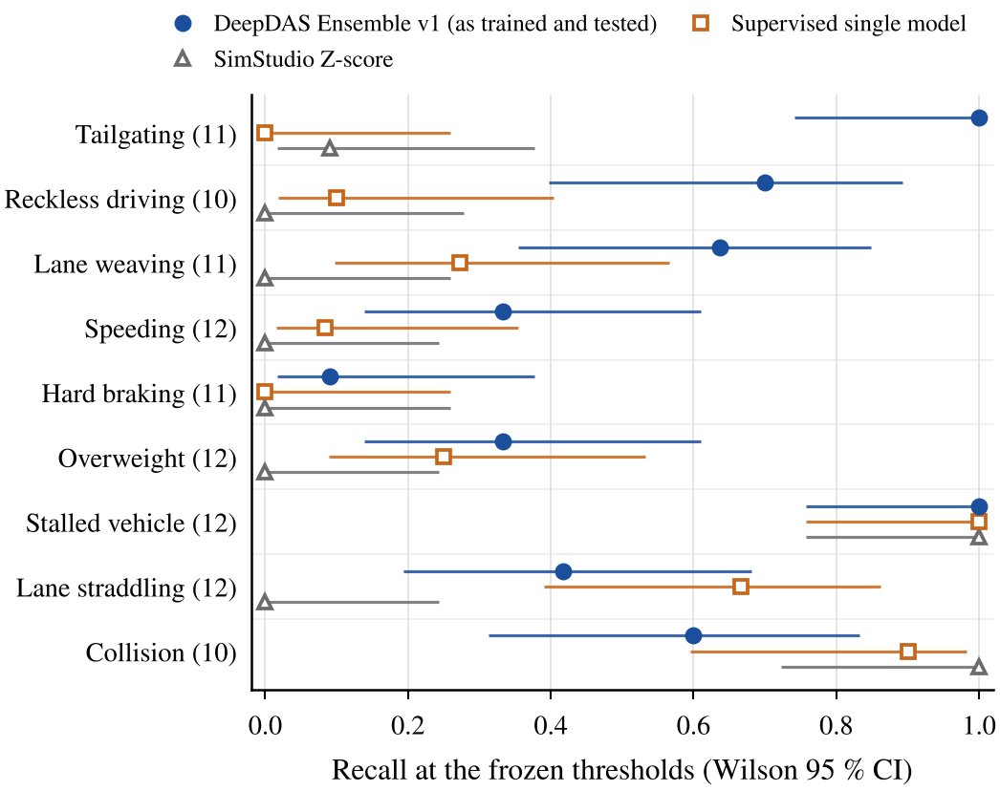

<p align="center">
  
</p>

<h1 align="center">DeepDAS</h1>

<p align="center"><b>Vehicle-level anomaly detection from fused fibre-optic (DAS), camera and GPS tracks with a deep ensemble</b><br>
Deep Learning course project, Tel Aviv University, 2026</p>

<p align="center">
  <a href="INSTALL.md">Install</a> ·
  <a href="#quick-start">Run</a> ·
  <a href="#results">Results</a> ·
  <a href="research/README.md">Research questions</a> ·
  <a href="models/">Models</a> ·
  <a href="docs/DATA_PACKAGE.md">Data</a> (<a href="https://github.com/noasapir3/Deep-DAS/releases/tag/data-v1.0">download</a>) ·
  <a href="figures/README.md">Figures</a> ·
  <a href="report/">Report</a>
</p>

---

A buried telecom fibre can serve as a continuous traffic sensor. Distributed acoustic sensing (DAS) turns each metre of fibre into a vibration channel.

**The earlier project.** In **SimStudio**, DAS detections were fused with camera and GPS detections into vehicle tracks, and a hand-crafted Z-score model flagged anomalous drivers. That model missed three behaviours: lane weaving, lane straddling and tailgating.

**DeepDAS asks whether a deep model learned from the track sequences detects these behaviours, and at what false-alarm cost.**

- **The task is binary detection.** For each vehicle track the system outputs one score and one decision: *anomalous* or *normal*. It does **not** name the anomaly type; the nine simulated anomaly types are used to train it and to report recall per type.
- **Inputs.** The network sees only the fused tracks. No simulator-truth channel is an input. Truth is used to label vehicles and to verify that an injected anomaly really happened.
- **Scope.** Everything is simulated, except one real recording.

## The final model

<p align="center">
  
</p>

**DeepDAS Ensemble v1** is a hybrid of a learned encoder and one physical summary:

1. **Windows.** A 6.4 s window of the fused track (14 channels × 64 bins of 0.1 s) passes four `Conv1d + GELU` layers and a linear projection to an 8-d code.
2. **Pooling.** The codes of all windows of a track are pooled into their mean and standard deviation: **16 learned features**.
3. **Head.** One physical summary is added as the **17th input**: the tailgating fraction φ<sub>u</sub>, the share of valid time with a leader at headway < 0.8 s and speed > 5 m/s, computed from the tracks. The head is an MLP, 17 → 16 → 1.
4. **Ensemble.** Five independently trained networks are standardised with frozen statistics and averaged. The decision threshold τ = 1.973 is frozen; it is the 99th percentile on normal threshold-region vehicles.

The figure is generated from the frozen checkpoints, and every shape is asserted against the code. There is no max-pooling and no dropout. Details: [docs/ARCHITECTURE.md](docs/ARCHITECTURE.md) · **[current model card](models/MODEL_CARD_DeepDAS_Ensemble_v1.md)**: comparison on the common decided subset, both inference options, the Klausner check. The [original model card](models/deepdas_ensemble_v1/MODEL_CARD.md), as frozen with the model, is kept unchanged.

### One model, two ways to run it

The five networks were **trained, selected and tested with φ<sub>u</sub> active**. That hybrid model is the one all main results belong to. The code runs the same frozen weights in two explicitly named ways:

| Option | Flag | 17th head input | What it is | Results |
|---|---|---|---|---|
| **Active** (the original model) | `--phi-mode active` | standardised φ<sub>u</sub> | the hybrid exactly as trained, selected, frozen and tested | [`results/`](results/): every published number |
| **Neutralized** (dependence check) | `--phi-mode neutralized` | held at 0 | the same weights, μ<sub>k</sub>, σ<sub>k</sub> and τ, with the summary switched off at inference. It measures how much the trained model depends on φ<sub>u</sub>; it is **not** a model trained without φ<sub>u</sub>. Defined after the final test had been exposed. | [`results_phi_neutralized/`](results_phi_neutralized/) (post hoc) |

**Default.** If the flag is omitted, the code runs `active`, so the published results reproduce unchanged. The commands below always name the option. Full explanation: [docs/INFERENCE_MODES.md](docs/INFERENCE_MODES.md).

**What has a version, and what does not:**

| Thing | Version | What it means |
|---|---|---|
| The **trained model** | DeepDAS Ensemble v1 (frozen 2026-10-09) | one set of five checkpoints and one threshold. No other model was adopted after it. |
| The **inference option** | `active` / `neutralized` | how the same model is run (above) |
| The **release folders** | `DeepDAS_Release_v1.0` (seven studies) → `DeepDAS_Release_v1.1_review` (adds the `--phi-mode` option, study 08 and the Klausner experiment) | packaging of the same model; v1.0 is the frozen reference release |
| **This repository** | built from `v1.1_review` | the same model, code and results, plus documentation and figures |
| The **report** | v3, the final report (approved 2026-10-11); v2.2 and earlier are archived | [`report/`](report/) |

## Results

**The final test: 228 new simulated scenes in 8 held-out regions.**

- **Frozen in advance.** The plan, the models, the thresholds and the evaluation code were frozen before simulation, and the test was run once.
- **The detectors.** The table compares the three detectors that were frozen before the test.
- **The vehicles.** All three are scored on the **common decided subset**, the vehicles that every detector could decide: 101 verified anomalies and 1,008 normal vehicles.

| | DeepDAS Ensemble v1 (`active`) | Supervised single model | SimStudio Z-score |
|---|---|---|---|
| Macro recall, 9 types | **0.568** [0.49, 0.65] | 0.364 [0.30, 0.43] | 0.232 [0.22, 0.26] |
| ROC-AUC / AUPRC | **0.908 / 0.742** | 0.769 / 0.515 | 0.819 / 0.496 |
| Precision / F1 | 0.74 / **0.64** | 0.88 / 0.52 | 0.77 / 0.35 |
| False alarms, normal driving | 20 / 1,008 (2.0 %) | 5 / 1,008 (0.5 %) | 7 / 1,008 (0.7 %) |
| False alarms, legitimate stops < 10 s | 20 / 28 | 14 / 28 | 22 / 28 |
| Tailgating detected | **11 / 11** | 0 / 11 | 1 / 11 |

**Reading the table.**

- **Intervals.** Brackets are 95 % bootstrap intervals over runs.
- **One population per table.** Every column is on the same 101 + 1,008 vehicles. The Z-score's own, larger decided set gives different values (105 anomalies and 1,574 normals; ROC-AUC 0.783, AUPRC 0.394). Those are not mixed into this table.
- **Coverage.** The deep models give no decision for 700 of 1,708 normal vehicles (41 %): tracks that are too short or not usable. Undecided vehicles are never counted as normal.

<p align="center">
  
</p>

**What the curves show.**

- **Ranking.** The ensemble lies above both baselines over almost the whole range.
- **Operating points.** Open markers are the frozen operating points.
- **What the curves are not.** They rank vehicles: no threshold was chosen from them, and the test selected nothing.

<p align="center">
  
</p>

**Where the gain is.**

- **Gains over the Z-score:** tailgating (11/11) and lane weaving (7/11), which the Z-score detects 1/11 and 0/11 times, and reckless driving (7/10).
- **Detected by all three:** stalls (12/12).
- **Still weak for the ensemble:** hard braking (1/11, weak for every detector), speeding (4/12) and overweight (4/12).
- **Where a baseline is better:** on straddling the single model (8/12 vs 5/12); on collision both baselines (9/10 and 10/10 vs 6/10).
- **Intervals:** Wilson 95 %. With 10–12 vehicles per type, they are wide.

**Development and validation.** These sets were used for design and selection, so they are not independent.

- **Development:** 8 of the 9 development cases are detected.
- **Validation:** macro recall 0.714, AP 0.781, tailgating 12/13.
- **More:** all tables are in [results/README.md](results/README.md).

**The neutralized option (post hoc).** With the same weights and φ<sub>u</sub> held at 0:

| Check | `active` (as tested) | `neutralized` |
|---|---|---|
| Development cases detected (9) | 8 / 9 | 7 / 9 (loses the tailgating case) |
| Tailgating, validation | 12 / 13 | 9 / 13 |
| Tailgating, exposed final test (post hoc) | 11 / 11 | 10 / 11 |
| Macro recall, exposed final test (post hoc) | 0.568 | 0.560 |

The full analysis, with its four-configuration figures, is in [study 08](research/08_tailgating_feature_intervention/).

**Main limitations** ([docs/LIMITATIONS.md](docs/LIMITATIONS.md)):

- many false alarms on legitimate short stops and on tailgating matched controls;
- weak recall on hard braking, speeding, overweight and straddling;
- decision coverage set by the tracker;
- simulation only, except for one real recording (a stalled bus, detected).

## Research: four questions behind the design

Each design change answered one question with a pre-registered comparison. The [research index](research/README.md) gives the answer to each question and links every study. [docs/QUESTION_MAP.md](docs/QUESTION_MAP.md) maps each question to its section in the report and to its evidence files.

| Question | Answer in one line | Studies |
|---|---|---|
| **Q1.** Why was reconstruction error not enough, and why supervised learning? | The anomalies sit inside the normal range of a window (AUROC 0.60 vs 0.89). The encoder was kept and a supervised head added: 7/9 development cases. | [01](research/01_unsupervised_autoencoder/), [02](research/02_supervised_single_model/) |
| **Q2.** How did training stability and data diversity affect detection? | Single models are seed-dependent, so we used a five-seed ensemble. Varied tailgating data raised tailgating recall from 0.385 to 0.923, and three stop modes kept every seed at 18/18 stalls. | [02](research/02_supervised_single_model/), [03](research/03_tailgating_data/), [04](research/04_stall_diversity/) |
| **Q3.** Why do more detections not necessarily justify replacing the model? | Remedies for legitimate-stop alarms, and targeted data for the weak types (after the test was exposed), each broke a pre-registered condition. None was adopted. | [05](research/05_legitimate_stops/), [06](research/06_weak_type_diagnosis/), [07](research/07_targeted_data_study/) |
| **Q4.** What does the tailgating summary φ<sub>u</sub> add beyond the learned representation? | It decides one development case. Most test tailgaters stay detected without it (post hoc). No model without it was trained on the final training data; early models without it exist (study 02). | [08](research/08_tailgating_feature_intervention/) |

**Two further pages:**

- **[The final test](results/final_test/):** the single independent evaluation.
- **[The Klausner experiment](models/deepdas_ensemble_v1/experiment_klausner/):** the final model on the one real recording.

## Quick start

These commands were tested in a fresh clone (Linux x86-64, Python 3.13, CPU).

**Requirements:** Python ≥ 3.11 and no GPU. Memory, from the release documentation: about 2.5 GB for scoring, about 6 GB for the full verification with parallel workers.

```bash
# 1. environment (CPU build of PyTorch)
python3 -m venv .venv && . .venv/bin/activate
pip install --upgrade pip
pip install -r requirements.txt --extra-index-url https://download.pytorch.org/whl/cpu

# 2. check the installation and the frozen models (no data needed, a few seconds)
python scripts/check_models.py

# 3. data package (271 MB, release data-v1.0), unpacked into the repository root
curl -L -o DeepDAS_data_v1.0.zip https://github.com/noasapir3/Deep-DAS/releases/download/data-v1.0/DeepDAS_data_v1.0.zip
unzip -q DeepDAS_data_v1.0.zip -d . && sha256sum -c --quiet DATA_PACKAGE_SHA256.txt

# 4. the model on the nine development cases, in each option
python scripts/reproduce_development_cases.py outputs/dev_active      --phi-mode active        # 8 / 9, the published result
python scripts/reproduce_development_cases.py outputs/dev_neutralized --phi-mode neutralized   # 7 / 9, dependence check
```

[INSTALL.md](INSTALL.md) covers:

- full reproduction of validation and the final test, in both options;
- scoring your own imported runs;
- the Klausner recording;
- the tests;
- checking that results match the published files byte for byte.

## Repository map

```text
DeepDAS/
├── README.md                 ← this page
├── INSTALL.md                ← installation, data package, checks, reproduction
├── src/deepdas/              ← the Python package
│   ├── ensemble/             ←   DeepDAS Ensemble v1 detector, scoring, --phi-mode option
│   ├── model/                ←   convolutional autoencoder (the encoder)
│   ├── train/                ←   supervised training of the ensemble seeds
│   ├── evaluation/           ←   development, validation and final-test evaluation
│   ├── data/                 ←   import, map matching, 14 channels, windows, splits
│   ├── baseline/             ←   SimStudio Z-score baseline wrapper
│   ├── batches/, sim/        ←   generators of the simulated anomaly sets
│   └── fp/, fp_anomaly_model/←   SimStudio simulator, tracker and Z-score model (unchanged)
├── scripts/                  ← entry points: checks, reproduction, scoring, training, import
├── models/                   ← frozen models (small: 2.3 MB in total)
│   ├── MODEL_CARD_DeepDAS_Ensemble_v1.md ← the current model card
│   ├── deepdas_ensemble_v1/  ←   5 checkpoints, threshold, original model card, Klausner experiment
│   └── baselines/            ←   supervised single model, SimStudio Z-score
├── results/                  ← published results, option `active` (development / validation / final_test)
├── results_phi_neutralized/  ← the same evaluations, option `neutralized` (post-hoc analysis)
├── research/                 ← eight studies, indexed by the four research questions
├── figures/                  ← figure gallery: architecture, development, validation, final test, post hoc
├── report/                   ← the final 5-page report (v3, PDF + LaTeX); previous version in report/archive/
├── docs/                     ← architecture, data, evaluation protocol, limitations, question map, background
├── data/                     ← simulation plans and data description (processed data: separate package)
└── tests/                    ← unit and equivalence tests
```

| Folder | What is in it | Useful for |
|---|---|---|
| [`src/deepdas/`](src/) | Package code: data pipeline, encoder, ensemble detector, training, evaluation | developers |
| [`scripts/`](scripts/) | Command-line entry points with usage lines | anyone running the system |
| [`models/`](models/) | The frozen ensemble and the two baselines, with hashes | users, reviewers |
| [`results/`](results/) | Published tables and scores, kept apart by data role | readers checking a number |
| [`results_phi_neutralized/`](results_phi_neutralized/) | The neutralized-option outputs, every file stamped with its mode | reviewers of the φ<sub>u</sub> analysis |
| [`research/`](research/) | The four research questions and one page per study, with figures and reproduction steps | lecturers, researchers |
| [`figures/`](figures/) | All scientific figures with data and generating script | readers, report authors |
| [`report/`](report/) | The course report | lecturers |
| [`docs/`](docs/) | Technical documentation, the question map and the project background | everyone |
| [`data/`](data/) | What data exists and how to obtain it | anyone reproducing results |
| [`tests/`](tests/) | `pytest` suite; most tests need the data package (expected results in `tests/README.md`) | developers |

The repository keeps the folder layout of the release package (`DeepDAS_Release_v1.1_review`), so every code path is unchanged. [docs/REPOSITORY_MAP.md](docs/REPOSITORY_MAP.md) lists what was moved, added or left out.

## Background: the SimStudio fibre-sensing project

DeepDAS builds on **SimStudio** (Final Project No. 3221, Tel Aviv University: Noa Sapir and Nitai Dobrecki, supervised by Khen Cohen). That project built:

- a desktop simulator of North Tel Aviv traffic;
- DAS, camera and GPS sensor models;
- a Kalman tracker that fuses them into vehicle tracks;
- the Z-score anomaly model.

DeepDAS reuses the simulator and tracker unchanged and replaces the hand-crafted detector with a learned one.

<table>
<tr>
<td width="50%"></td>
<td width="50%"><br><br></td>
</tr>
<tr>
<td><sub>North Tel Aviv road network (OpenStreetMap) divided into simulation regions.</sub></td>
<td><sub><b>Top:</b> one laser pulse in, back-scattered light out; every metre of fibre is a channel. <b>Bottom:</b> the SimStudio Z-score detected 6 of 9 original anomaly scenarios and missed straddling, weaving and tailgating.</sub></td>
</tr>
</table>

**Klausner Street, the one real recording.** A city bus stands for about 31 s, which is a stall by the project's rule (stop ≥ 10 s).

- The SimStudio Z-score flagged it (max |z| = 27.5).
- The DeepDAS stage-1 autoencoder missed it.
- The final DeepDAS ensemble, run on it by inference only, **detects it** in both options (s<sub>u</sub> = 4.53 / 4.55 > τ = 1.973).

This is one real case, not a statistical evaluation ([Klausner experiment](models/deepdas_ensemble_v1/experiment_klausner/)).

What each project contributed, the physics, the anomaly model and the Klausner results with all figures: [docs/BACKGROUND_SIMSTUDIO.md](docs/BACKGROUND_SIMSTUDIO.md).

## Status and credits

- **Team.** Noa Sapir, Asaf Zini, Neta Shaboo. Their contributions, as stated in the report:
  - **Noa Sapir** led the technical and experimental work, with primary responsibility for designing and generating the simulation scenarios and datasets of this project (building on the SimStudio infrastructure of the earlier project), training the deep-learning models, and executing the experiments.
  - **Asaf Zini** contributed to preparing and checking simulation inputs and to technical validation of the experimental workflow.
  - **Neta Shaboo** contributed to the literature review and to organizing and editing the research documentation and report.
- **Use of software tools.** The team used software tools during the project, including the AI assistant Claude for coding, documentation and editing support. Tools are not team members.
- **Submission status.** What is final and what remains (publication of this documentation) is listed in [MISSING_BEFORE_SUBMISSION.md](MISSING_BEFORE_SUBMISSION.md).
- **License.** No license has been chosen for this repository yet. Until one is added, all rights are reserved by the authors.
- **Third-party material.** Credits and attributions are in [CREDITS.md](CREDITS.md).
