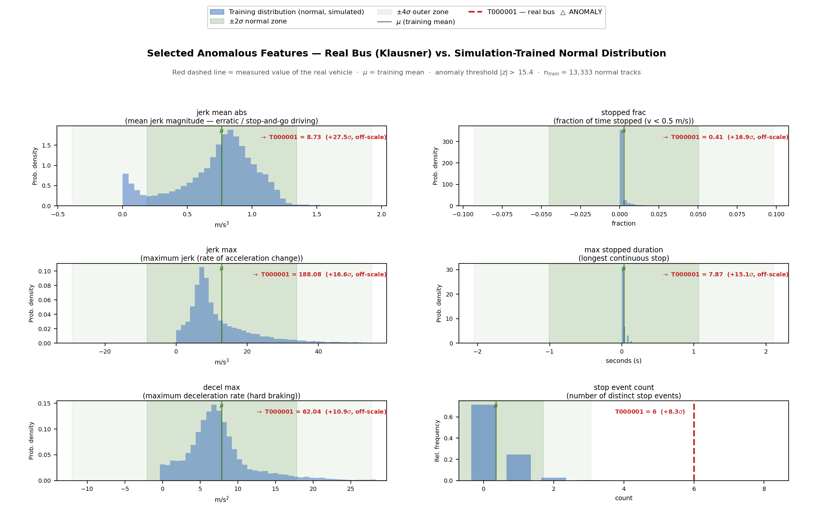

# Background: the SimStudio fibre-sensing project

DeepDAS continues **SimStudio**, a final project of the TAU School of Electrical Engineering:

- *Optical Fibers for Smart Cities: Fiber Optic (DAS) Sensing for Real-Time Vehicle Tracking and Road Anomaly Detection*, Final Project No. 3221, 2025–2026;
- students Noa Sapir and Nitai Dobrecki; supervisor Khen Cohen.

This page summarises what SimStudio built, and what DeepDAS adds on top of it. All images on this page come from the SimStudio final presentation, except the last one, which is a DeepDAS result.

## What SimStudio built

### A traffic simulator on the real street network

**The figure.** The North Tel Aviv road network, imported from OpenStreetMap and divided into simulation regions (tiles), as drawn in the SimStudio presentation.

**How SimStudio uses the network.** Vehicles drive on it with an IDM car-following model and stochastic speed profiles, and anomalies can be injected into chosen vehicles.

**How DeepDAS uses it.** DeepDAS uses the same simulator unchanged. It splits 148 regions spatially into training, model-selection, threshold and test regions.

### How one fibre becomes thousands of sensors

**How it works.**

- **The interrogator.** A φ-OTDR interrogator sends laser pulses into a buried telecom fibre.
- **Channels.** The light scattered back from each metre of fibre forms an independent channel.
- **The signal.** A passing vehicle loads the ground (force *F*) and strains the fibre. This shifts the optical phase of the back-scattered light, φ(t, ℓ), and the result is a strain-rate signal along the fibre.

**What can be read from it.**

- **Speed.** It is the slope of the vehicle's streak in the distance–time plane.
- **Weight.** The amplitude grows with the vehicle's weight and decays with its distance from the fibre. SimStudio inverts this relation, the Flamant–Boussinesq law, to estimate the weight.

### Sensors, tracking and fusion

- **Sensors.** The simulator produces DAS detections (30 Hz), camera detections (10 Hz, with dropouts) and GPS fixes (1 Hz).
- **Tracking.** A Kalman tracker fuses them into vehicle tracks and exports state rows at 50 Hz.

These fused tracks are the only input of the DeepDAS model.

### The Z-score anomaly model (the baseline)
SimStudio's detector is unsupervised: it learns the distribution of normal driving and scores each vehicle by its deviation.

- **Fingerprint.** Each trajectory becomes a behavioural fingerprint of 166 features in 9 groups, of which 156 are scored; identifiers and metadata are excluded.
- **Decision.** A vehicle is flagged when its largest per-feature |Z| exceeds a conservative threshold, and the model reports which features drove the flag.

| Feature group | Features |
|---|---|
| Coverage and sensor utility | 54 |
| Kinematics | 35 |
| Inter-vehicle interaction | 20 |
| Kalman-filter quality | 13 |
| Sensor disagreement | 11 |
| DAS signal quality | 11 |
| Camera and GPS | 8 |
| DAS weight estimation | 3 |
| Scenario context | 1 |

In DeepDAS this model is the frozen comparison baseline, with its threshold of 15.39 σ.

**The original SimStudio result.** The figure shows the anomaly score of the injected vehicle in each of the nine original scenarios.

- **Detected (6 of 9):** hard braking, stalled vehicle, collision, reckless driving, speeding and overweight.
- **Missed:** lane straddling, lane weaving and tailgating stay far below the threshold.

**Note on the threshold.** The dashed line is the threshold as drawn in the original figure, 15.8 σ. The frozen model used for every comparison in DeepDAS has the threshold 15.39 σ.

**Why these three misses matter.** They are the motivation for DeepDAS.

### Real-world check on Klausner Street

**The recording.** SimStudio recorded one real event with a DAS channel on an existing telecom fibre and a camera on Klausner Street, next to the TAU campus.

- **Event.** A city bus slows down, stands at a bus stop and pulls away.
- **Processing.** The recording was replayed through the unchanged pipeline on the true street geometry.
- **Tracking accuracy (as reported in the presentation):**
  - fused track RMSE 1.17 m;
  - DAS per-sensor RMSE 0.33 m;
  - camera per-sensor RMSE 2.49 m.

**The figure.** Six features of the real bus (red line) against the distribution learned from simulated normal tracks.

**What the Z-score did.** It flags the bus at max |z| = 27.5, far beyond the threshold. The top feature is the mean absolute jerk. The presentation describes the signature as repeated, prolonged stopping:

- 41 % of the run stopped;
- longest continuous stop 7.9 s;
- 6 stop events.

The real DAS-derived kinematics are much noisier than the simulated ones.

## What DeepDAS adds

| | SimStudio | DeepDAS |
|---|---|---|
| Detector | hand-crafted Z-score over 156 track features | learned 1-D convolutional encoder over 14 track channels, supervised head, 5-network ensemble |
| Training signal | normal driving only | normal driving + simulated anomalies whose labels are verified against simulator truth |
| Simulator-truth inputs | 13 of the 156 features use the position error against truth | none (truth only labels vehicles) |
| Evaluation | the nine original scenarios | spatial splits, development / validation / a pre-registered, frozen final test of 228 new scenes |
| Tailgating, lane weaving | missed | detected on the final test: 11/11 and 7/11 |
| Main cost | – | false alarms on legitimate stops < 10 s |

## The Klausner recording with the DeepDAS models
The same real track was run through the DeepDAS models:

- the stage-1 autoencoder of study 01 (archived);
- the final ensemble, inference only, in both options ([experiment](../models/deepdas_ensemble_v1/experiment_klausner/)).

| Detector | Decision on the real bus |
|---|---|
| SimStudio Z-score | flagged (max \|z\| = 27.5 > 15.39) |
| DeepDAS stage-1 autoencoder (study 01) | not flagged (track score 2.15 < 5.20) |
| **DeepDAS Ensemble v1, φu active / neutralized** | **ALARM** (su = 4.53 / 4.55 > τ = 1.973) |

**What the figure shows.**

- **Left:** the tracked speed, acceleration and DAS measurements of the real bus.
  - The tracked speed stays below 1 m/s for 17.5 s, but with brief interruptions: the longest continuous stop below 0.5 m/s is 7.9 s, in 6 stop events.
  - The noise around arrival and departure is much larger than in the simulation.
- **Right:** the final model's ensemble score against the frozen threshold, in both options.

**How far this result goes.** This is one **unlabelled** track, so the result is an observation, not an evaluation. A bus stopping at a bus stop is ordinary traffic, so this alarm cannot be called correct or incorrect. One track also cannot tell whether the score is driven by:

- the long, repeated stopping, which resembles the stop patterns the model learned (stalls are stops of 10 s or more in the simulation's labels);
- or the real sensor noise, which lies outside the training distribution.
