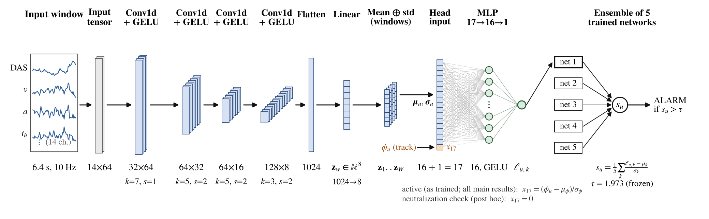
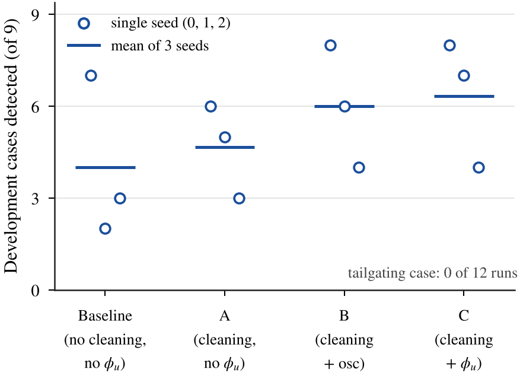
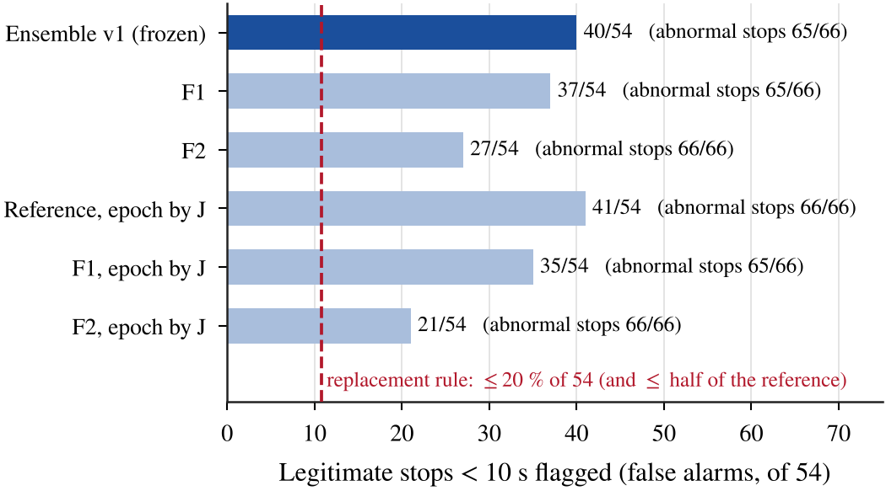
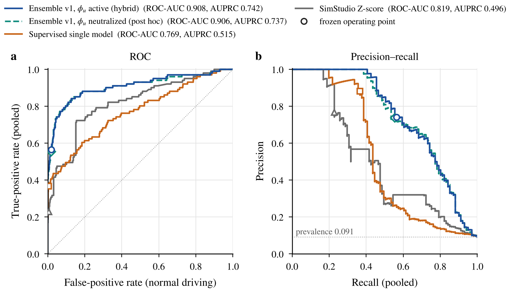
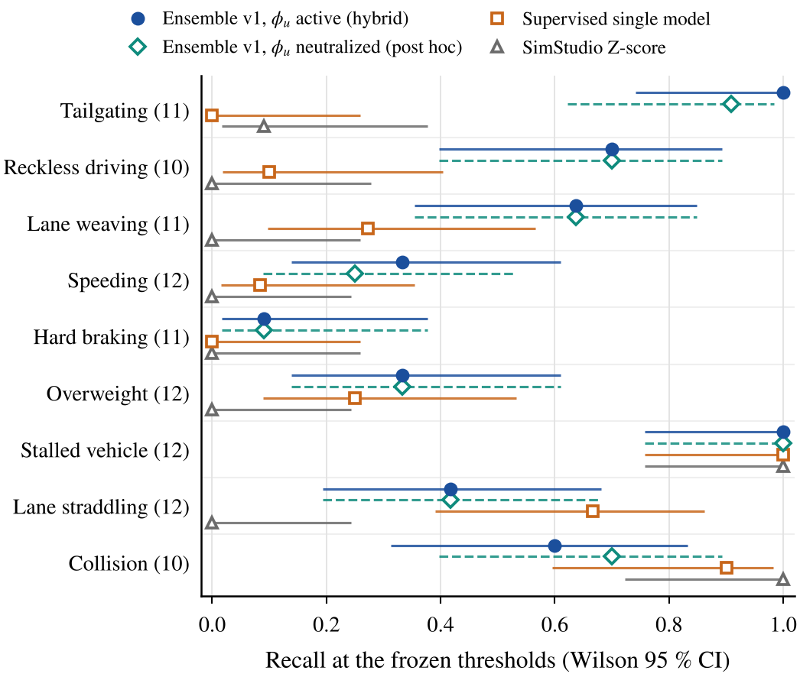
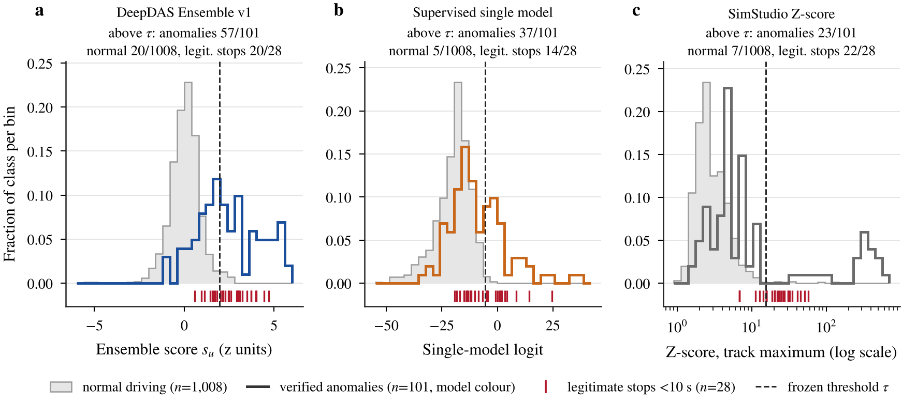
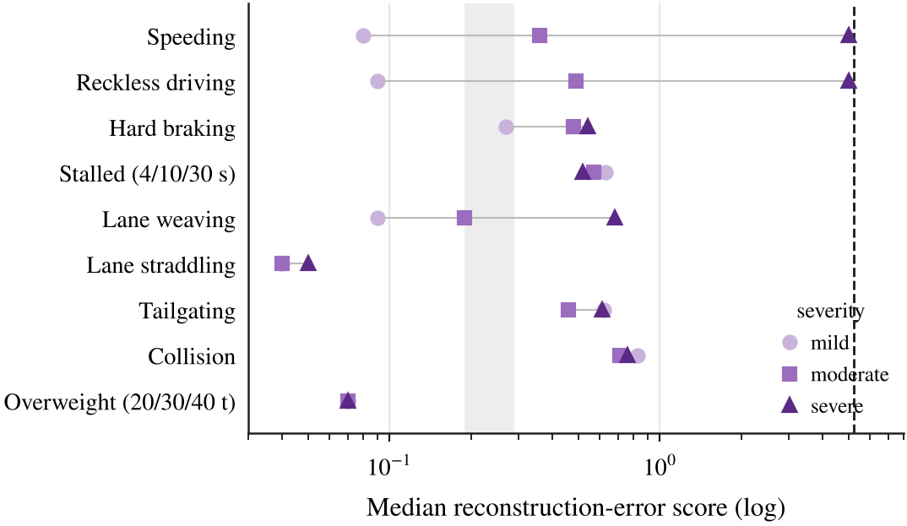
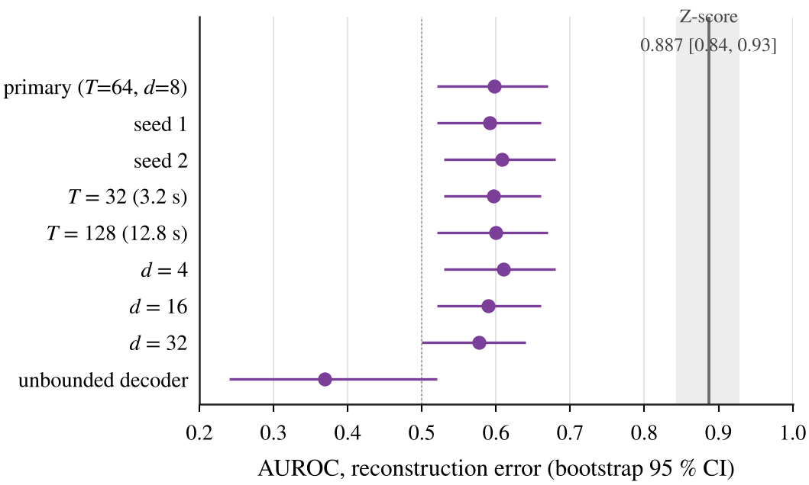
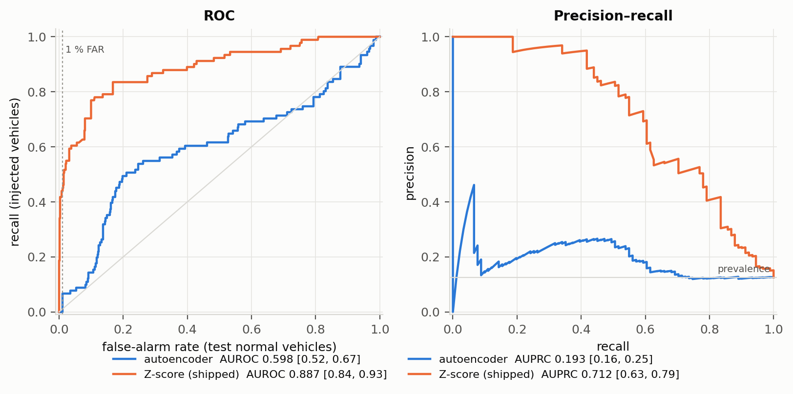
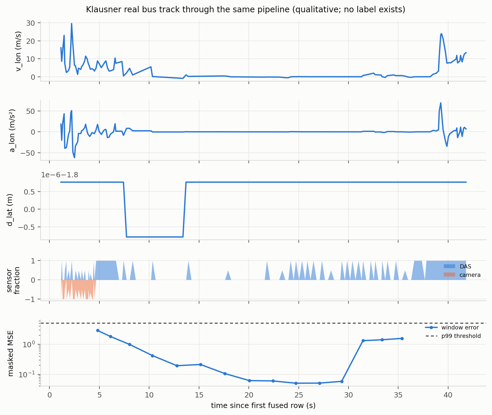

# Figure gallery

The gallery holds every scientific figure of the project, grouped by **the role of the data it shows**.

**For each figure:**

- a preview;
- the high-resolution PDF;
- the CSV with the exact numbers drawn;
- the script that generates it.

**What the figures are based on.** They are drawn only from research data and from architecture definitions checked against the code. No illustrative or AI-generated image is used as evidence.

**Common style:**

- serif text, white background;
- units and denominators on the axes;
- a fixed colour per model:

| Colour | Model |
|---|---|
| dark blue, solid, filled circle | DeepDAS Ensemble v1, φ<sub>u</sub> **active** (hybrid, as trained and tested) |
| teal, dashed / hatched, open diamond | DeepDAS Ensemble v1, φ<sub>u</sub> **neutralized** (post-hoc option) |
| orange, square | supervised single model |
| grey, triangle | SimStudio Z-score |

**Data roles:**

- **Development:** used for design.
- **Validation:** used for selection.
- **Final test:** independent only for the three detectors frozen before it.
- **Post hoc:** analyses defined after the final test was exposed.

**Regenerating the figures** (from the repository root):
```bash
python figures/scripts/make_report_figures.py      # V3, V5, S1, S2           (needs results/ and research records only)
python figures/scripts/make_study_figures.py       # S02, S05, S06            (research records only)
python research/08_tailgating_feature_intervention/code/make_figures.py   # G1-G4 (results/ and results_phi_neutralized/)
python figures/scripts/make_architecture_figure.py # G0                        (needs the data package for the input traces)
```

---

## Contents

1. [Architecture](#1-architecture)
2. [Development data](#2-development-data)
3. [Validation data](#3-validation-data)
4. [Final test](#4-final-test)
5. [Post-hoc analyses](#5-post-hoc-analyses)
6. [Real-data observation](#6-real-data-observation)
7. [Archived: stage 1 (autoencoder)](#7-archived-stage-1-autoencoder)

## 1. Architecture



**G0: DeepDAS Ensemble v1 at inference.**

- **What is drawn.** Every shape, kernel, stride, layer width, the parameter count and τ are read from the frozen checkpoints and asserted.
- **The 17th head input (amber).** It is drawn with both options: the standardised φ<sub>u</sub> in the model as trained (all main results), and 0 in the post-hoc neutralization check.
- **Layers.** There is no max-pooling and no dropout.

[PDF](architecture/pdf/G0_architecture_two_options.pdf) · [spec](architecture/data/G0_architecture_two_options_spec.json) · [script](scripts/make_architecture_figure.py)

## 2. Development data
*The 9 development cases, one per type, were used for design decisions. They are not independent.*



**S02: Study 02, development cases detected per seed (single models, early data).**

- **The comparison.** The same recipe with seeds 0, 1 and 2 detects anywhere from 2 to 8 of the 9 cases. This seed dependence is why every later model is a 5-seed ensemble.
- **Tailgating.** No arm detects the tailgating case, with or without φ<sub>u</sub>.

[PDF](development/pdf/S02_seed_dependence.pdf) · [data](development/data/S02_seed_dependence.csv) · [script](scripts/make_study_figures.py) · [study 02](../research/02_supervised_single_model/)

## 3. Validation data
*Validation regions, used to select models. Not independent.*


**V5: Controlled comparisons. Each panel changes one factor and shows every seed.**

- **(a) Study 03.** The same recipe (with φ<sub>u</sub>) without and with the varied tailgating data: validation tailgating recall 0.385 → 0.923.
- **(b) Study 04.** 24 added stall slots, as one stop mode repeated three times or three different modes. Both ensembles reach 18/18, but one repeated-mode seed falls to 0.67.
- **(c) Study 07, W1/W2.** Weak-type recall against false alarms on 54 legitimate stops. The targeted data roughly doubles weak-type recall, but both arms cross the pre-registered limit C5 (dashed).
- **Why W1/W2 is included.** It shows that the weak types are learnable. Its status: validation only, trained after the final test had been exposed, and not adopted.

[PDF](validation/pdf/V5_controlled_comparisons_3panel.pdf) · [data](validation/data/V5_controlled_comparisons_3panel.csv) · [script](scripts/make_report_figures.py)



**S05: Study 05, three remedies for false alarms on legitimate stops < 10 s.**

- **The remedies.** Controlled exposure (F1), a temporal branch (F2), and checkpoint choice by a task rule (J). Each ensemble is at its own val_B P99.
- **The outcome.** They reduce the alarms from 40 to as low as 21 of 54, but none reaches the pre-registered replacement rule while keeping the other conditions. This is the model's main limitation.

[PDF](validation/pdf/S05_legitimate_stop_remedies.pdf) · [data](validation/data/S05_legitimate_stop_remedies.csv) · [script](scripts/make_study_figures.py) · [study 05](../research/05_legitimate_stops/)

## 4. Final test
*228 new scenes in 8 held-out regions, planned, frozen and run once.*

- **Independent** for the hybrid (`active`), the single model and the Z-score.
- **Common decided subset:** 101 anomalies and 1,008 normal vehicles.
- **The neutralized series (dashed, teal) is post hoc.**



**G4: ROC and precision–recall from the saved scores.**

- **Operating points.** Open markers are the frozen operating points.
- **The two options.** The hybrid ensemble lies above both baselines over almost the whole range, and the neutralized option almost coincides with it (ROC-AUC 0.908 vs 0.906).
- **What not to read into it.** The curves rank vehicles. No threshold was chosen from them.

[PDF](../research/08_tailgating_feature_intervention/figures/pdf/G4_roc_pr_four_configurations.pdf) · [data](../research/08_tailgating_feature_intervention/figures/data/G4_roc_pr_four_configurations.csv) · [script](../research/08_tailgating_feature_intervention/code/make_figures.py)



**G3: Recall per anomaly type at the frozen thresholds.**

- **Intervals.** *n* is in brackets, with Wilson 95 % intervals.
- **Where the deep models gain.** On tailgating and weaving.
- **Weak for everyone.** Hard braking is weak for every detector (at most 1/11).
- **The two options.** Speeding, collision and tailgating differ by one vehicle each.

[PDF](../research/08_tailgating_feature_intervention/figures/pdf/G3_detection_by_type_four_configurations.pdf) · [data](../research/08_tailgating_feature_intervention/figures/data/G3_detection_by_type_four_configurations.csv) · [script](../research/08_tailgating_feature_intervention/code/make_figures.py)



**V3: Score distributions of the three frozen detectors on the final test.**

- **Normal driving:** grey histogram.
- **Verified anomalies:** coloured outline.
- **Legitimate stops < 10 s:** red ticks.
- **Threshold:** dashed.

The panel titles give the counts above the frozen threshold. The legitimate stops sit among the anomalies rather than among normal driving, which is the false-alarm problem of study 05.

[PDF](final_test/pdf/V3_score_distributions.pdf) · [data](final_test/data/V3_score_distributions_counts.csv) · [script](scripts/make_report_figures.py)

## 5. Post-hoc analyses
*Defined after the final test was exposed, so they are diagnostic only. They select nothing and change no reported result.*

 

**G1 (development cases) and G2 (tailgating): the frozen hybrid with φ<sub>u</sub> active vs neutralized.**

- **G1.** Only the tailgating development case changes decision (3.73 → −0.08); the other eight move by ≤ 0.034.
- **G2.** Tailgating recall falls from 12/13 to 9/13 on validation, and from 11/11 to 10/11 on the exposed test.
- **What this does and does not measure.** It is the dependence of the trained model on the feature, not the performance of a model trained without it.

G1: [PDF](../research/08_tailgating_feature_intervention/figures/pdf/G1_development_cases_phi_dependence.pdf) · [data](../research/08_tailgating_feature_intervention/figures/data/G1_development_cases_phi_dependence.csv) · G2: [PDF](../research/08_tailgating_feature_intervention/figures/pdf/G2_tailgating_detection_two_options.pdf) · [data](../research/08_tailgating_feature_intervention/figures/data/G2_tailgating_detection_two_options.csv) · [script](../research/08_tailgating_feature_intervention/code/make_figures.py) · [study 08](../research/08_tailgating_feature_intervention/)


**S06: Study 06, where the weak types are lost.**

- **What is measured.** The AUC against normal tracks of three things: simple input statistics (logistic probe), the pooled encoder code (linear probe), and the frozen ensemble score.
- **The finding.** The information is present in the input and survives the encoder. Most of it is lost in the head, which saw about four examples per type.
- **Status.** This uses the exposed final-test tracks, so it is post-hoc diagnosis.

[PDF](post_hoc/pdf/S06_information_flow_weak_types.pdf) · [data](post_hoc/data/S06_information_flow_weak_types.csv) · [script](scripts/make_study_figures.py) · [study 06](../research/06_weak_type_diagnosis/)

## 6. Real-data observation


**Klausner experiment: the final model on the one real recording.**

- **The result.** The real recording is a city bus on Klausner Street that stands for about 31 s (shaded), a stall by the project's rule. The model detects it in both options (s<sub>u</sub> = 4.53 / 4.55 > τ = 1.973).
- **Status.** One real case, labelled by applying the stall rule to its measured DAS speed; not a statistical evaluation.

[PDF](../models/deepdas_ensemble_v1/experiment_klausner/figures/klausner_experiment.pdf) · [scores](../models/deepdas_ensemble_v1/experiment_klausner/klausner_scores.csv) · [script](../models/deepdas_ensemble_v1/experiment_klausner/run_klausner_experiment.py) · [experiment page](../models/deepdas_ensemble_v1/experiment_klausner/)

## 7. Archived: stage 1 (autoencoder)
*Values from the archived study-01 report. The two figures in the first row are redrawn in the common style from those archived values; the original runs are not regenerated by this repository.*

 

**S2 and S1: why reconstruction error failed (study 01).**

- **S2.** The median reconstruction-error score per type and severity stays below the operating threshold for every type; only severe speeding and severe reckless driving come close.
- **S1.** AUROC stays near 0.6 whatever the seed, window length or bottleneck width.

S2: [PDF](archived_stage1/pdf/S2_ae_severity_archived.pdf) · S1: [PDF](archived_stage1/pdf/S1_ae_sensitivity_archived.pdf) · [data](archived_stage1/data/S1_ae_sensitivity_ARCHIVED.csv) · [script](scripts/make_report_figures.py)

 

**Original stage-1 figures, in their original style (archived files, not regenerated).**

- **Left.** ROC and precision–recall of the autoencoder (AUROC 0.598) against the Z-score (0.887) on the stage-1 test set.
- **Right.** The Klausner track through the autoencoder: the window error stays below its threshold.

[study 01](../research/01_unsupervised_autoencoder/)
