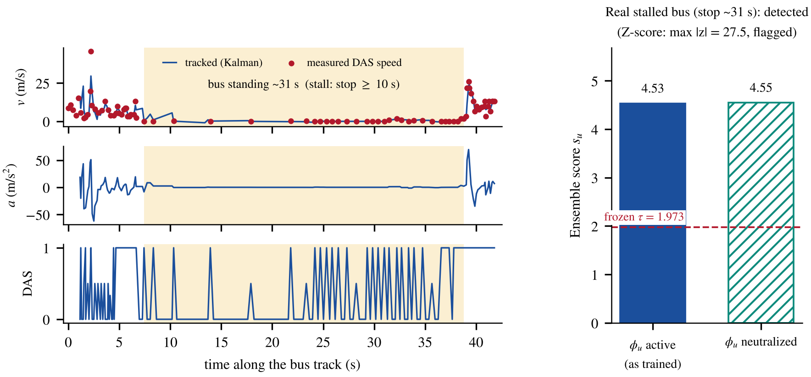

# Klausner experiment: the final model on the one real recording

**Status:** inference only. Nothing was trained, re-calibrated or changed. The run used the five frozen checkpoints, their frozen statistics and the frozen threshold τ = 1.973. The recording was not part of any training, selection or test set.

## Research question
Does DeepDAS Ensemble v1, trained only on simulated tracks, detect the real stalled bus recorded on Klausner Street? How does it compare with the earlier detectors?

## Data and label
**The recording.** It is the real export of SimStudio (`data/simstudio_inputs/klausner/`, part of the data package), described there as *“Real DAS event #4 + cam2”*. One real DAS channel on an existing telecom fibre and one camera on Klausner Street, next to the TAU campus, recorded a 12 t city bus that drives in, stands, and pulls away. The fused track lasts 41.8 s and has 175 valid 0.1 s bins and 15 windows.

**How the track was processed.** It was imported with the unchanged pipeline used for every simulated run:
- map matching on the real street geometry;
- the 14 input channels;
- the DAS amplitude from the Kalman audit sheet;
- the quality gate.

**The label.** A real recording has no simulator truth, so the project's stall rule (`docs/ANOMALY_TYPES.md`: a stop of **10 s or more is a stall**; a stop of 1 to < 10 s is a legitimate stop) is applied to the bus speed measured by DAS (`klausner_das_speed.csv`, from the export's Kalman Audit sheet):

| Measured DAS speed | Duration of the stop |
|---|---|
| below 0.5 m/s, continuously | **23.6 s** (from 7.4 s to 31.0 s) |
| below 2 m/s, continuously | **31.4 s** (from 7.4 s to 38.8 s) |

**Result of the rule:** the stop is well above 10 s, so the track is an **anomaly: stalled vehicle**.

## Result

| Detector | Decision on the stalled bus | Score | Source |
|---|---|---|---|
| **DeepDAS Ensemble v1, φ<sub>u</sub> active** (as trained) | **detected (ALARM)** | s<sub>u</sub> = 4.53 > τ = 1.973 | `klausner_scores.csv` (this run) |
| **DeepDAS Ensemble v1, φ<sub>u</sub> neutralized** | **detected (ALARM)** | s<sub>u</sub> = 4.55 > τ = 1.973 | `klausner_scores.csv` (this run) |
| Supervised single model | detected | logit 18.8 > −5.52 | `klausner_scores.csv` (this run) |
| SimStudio Z-score (shipped model) | detected | max \|z\| = 27.5 > 15.39 (top feature: mean absolute jerk) | `klausner_track_summary.json` (this run) |
| Stage-1 autoencoder (study 01) | **missed** | track score 2.15 < 5.20 | archived: `research/01_unsupervised_autoencoder/records/unsup_REPORT.md` §4.6 |

**Per seed.**
- All five seeds alarm individually, with seed logits 6.6, 7.8, 7.7, 9.3 and 3.5.
- Every per-seed z is between 3.3 and 6.0, above τ.

**The two options agree.** φ<sub>u</sub> = 0 for this bus, because it never follows a leader closely, so neutralizing the 17th input barely changes the score: 4.53 vs 4.55.

## Figure

<p align="center"></p>

**Left panel.**
- **What is drawn:** the tracked speed, acceleration and DAS-measurement indicator of the bus. The red dots are the speeds measured by DAS.
- **The shaded band:** the stop of about 31 s.
- **What the tracker does to it:** the Kalman-tracked speed shows the stop with brief interruptions and very noisy arrival and departure (|a| up to about 70 m/s²). Earlier SimStudio features computed from the tracked speed therefore report a fragmented stop: the longest continuous stop was 7.9 s, in 6 stop events. This is the tracker effect described in the report: the tracker compresses stop duration.

**Right panel.** The ensemble score in both options, against the frozen threshold.

## Conclusion and limits
- **Result.** The final model detects the real stalled bus in both inference options. So do the supervised single model and the SimStudio Z-score. The stage-1 autoencoder misses it.
- **Limits:**
  - **One case.** This is a single real case. It shows that a model trained only on simulation transfers to this recording, through the unchanged pipeline. It is not a recall or false-alarm estimate on real data.
  - **The label.** The label applies the simulation's stall rule to the measured DAS speed, because no independent ground truth exists for the recording.
  - **The noise.** The real tracked kinematics are much noisier than the simulated ones. With one track it cannot be separated how much of the score comes from the stop and how much from that noise.

## How to reproduce
From the repository root, with the data package unpacked (a few seconds on CPU):
```bash
python models/deepdas_ensemble_v1/experiment_klausner/run_klausner_experiment.py
```
The script scores the track in both options and writes its files next to itself.

| File | Content |
|---|---|
| `run_klausner_experiment.py` | the experiment: import, label from the DAS speed, scoring in both options, Z-score, figure |
| `klausner_scores.csv` | per option: windows, five seed logits, ensemble score, decision, φ<sub>u</sub>, τ; single-model logit and decision |
| `klausner_das_speed.csv` | the measured DAS speed of the bus over time (the evidence for the label) |
| `klausner_track_summary.json` | the label, all detectors, track facts, and the archived autoencoder result and its source |
| `figures/klausner_experiment.{png,pdf}` | the figure above |
