## Abstract

Distributed acoustic sensing (DAS) turns a buried telecom fibre into a dense array of traffic sensors, and the SimStudio Final Project fused simulated DAS, camera and GPS detections into per-vehicle Kalman tracks and flagged anomalous drivers with a hand-crafted Z-score model. This project asks whether a deep model trained on *normal* tracks only can replace the hand-crafted features. We train a 1-D convolutional autoencoder on 10 Hz road-frame windows (speed, lateral offset, speed-limit ratio, gap and headway to the vehicle ahead, plus sensor-presence masks) derived from the Final Project's existing exports without any simulator ground truth, score vehicles by reconstruction error, and compare with the shipped Z-score model, unchanged, on the nine published anomaly scenarios and on a new targeted severity study (9 anomaly types × 3 severity levels × 3 seeds, simulated with the copied, unchanged simulator). The evaluation is vehicle-level on held-out regions with a one-tile spatial buffer. The autoencoder's reconstruction error responds monotonically to injected severity for speeding, braking, weaving and reckless driving, but only speed violations of about twice the limit leave the envelope of normal driving: on 91 injected vehicles versus 632 held-out normal vehicles it reaches AUROC 0.60 [0.52, 0.67] and detects 1 of 91 at a 1 % false-alarm rate, whereas the Z-score model reaches AUROC 0.89 [0.84, 0.93] and 44 % recall. The paper explains the gap with the model's reconstructions: a bottleneck of eight numbers encodes little more than the window means of the six target channels, larger bottlenecks reconstruct the anomalies as faithfully as normal windows, and the anomalies of this simulator — stops, moderate braking, lateral drift of one to two metres, close following — lie inside the span of its normal driving, which the Z-score model separates with track-level statistics (stop counts, duration) and with features computed from simulator ground truth (DAS amplitude, true lateral offset). All code, data pipeline and figures are reproducible from a self-contained directory that never imports the parent project.

## 1. Introduction

The Final Project built a traffic simulator (SimStudio) with three sensor models — a DAS fibre along the road, roadside cameras and sparse GPS — a multi-sensor tracker and a Kalman filter, and it detected anomalous vehicles with a Z-score model over 156 hand-crafted per-track features [FP report]. The approved proposal for this course project ("Deep DAS") replaces the feature engineering with an unsupervised deep model: a 1-D convolutional autoencoder (AE) trained on normal driving only, scoring each vehicle by how badly its fused track is reconstructed, with the shipped Z-score model as the baseline, a controlled severity study, and an analysis of sensitivity to the DAS noise level.

Before writing code we audited the Final Project (Phase 1, `docs/DESIGN_phase1_forensics.md`). Three findings shaped the work. First, ground truth enters the shipped pipeline in several places: the tracker is oracle-aided, every Kalman filter is initialised at the true position, camera/GPS velocity measurements are noise-free, and 58 of the 156 Z-score features are computed from simulator truth. Second, three of the nine published anomaly scenarios did not inject what their names say (the "hard braking" vehicle is frozen from the start, the "lane straddling" offset is 0 m, the "tailgating" vehicle never comes closer than 8.9 m). Third, several of the proposal's severity levels sit inside the simulator's normal driving envelope by construction (braking up to 4 m/s², lateral drift up to ±1.8 m, 1.12× the speed limit). The design review therefore fixed the scope: reuse the existing exported trajectories exactly, keep the Z-score model as shipped (its truth-derived features documented as a limitation rather than "cleaned"), apply the no-truth rule to the deep model only, run the smallest severity study that can produce recall-versus-severity curves, and answer the DAS-noise question observationally (`docs/DESIGN_phase2_plan.md`).

Contributions. (i) A self-contained, tested pipeline (`DL/`) that imports the Final Project's exports without ground truth, map-matches the Kalman tracks, and builds a 13-channel 10 Hz representation. (ii) A seeded, deterministic re-run of the copied simulator for 81 severity variants that change only the injected vehicle, with the realised severity measured from the simulator's own truth. (iii) A vehicle-level, spatially blocked evaluation of the AE against the shipped baseline with bootstrap intervals, matched false-alarm rates, recall-versus-severity curves, false alarms by scenario type, DAS-σ strata and a sensitivity study over seeds, window length and bottleneck width. (iv) A diagnosis of why reconstruction error fails here, supported by the reconstructions themselves and by the bottleneck sweep, and a qualitative check on the one real DAS track of the Final Project.

## 2. Data

### 2.1 The Final Project pipeline and its exports

SimStudio steps at 50 Hz: intelligent-driver-model car following (braking clamped at 4 m/s²), an Ornstein–Uhlenbeck lateral drift (τ = 1.5 s, σ = 0.9 m, clamped at ±1.8 m) and a per-vehicle stochastic speed profile capped at 1.12× the segment limit. DAS produces a noisy 2-D position at 25 Hz (σ = max(0.3, 2/√SNR) plus a 0.2 m lane term, SNR = A/8 with amplitude A = W/(r + 0.7)² from the true weight W and fibre distance r); cameras produce positions at ≈ 10 Hz with stochastic drops; GPS at ≈ 1 Hz. A `TrackManager` associates measurements to tracks and one 6-state constant-acceleration Kalman filter per track fuses them. The batch runner exports, per scenario, `tracking_audit.xlsx` with one sheet per track: the 50 Hz Kalman state, the raw measurements, and truth columns. These exports — 1,776 normal scenarios (148 map tiles of northern Tel Aviv × 12 scenario types, 14,423 tracks) and the nine anomaly scenarios — are the only external input of this project. `docs/LEAKAGE_AUDIT.md` lists every column and its fate: the Kalman state and the sensor-presence flags are kept, every truth column is dropped at import, and the oracle vehicle id is used only as the label key.

### 2.2 Anomaly scenarios and the severity study

The nine published scenarios each place four vehicles in one region; one carries an override (speeding, hard braking, stalled vehicle, lane weaving, tailgating, lane straddling, collision, overweight vehicle, reckless driver). The other three are *background* vehicles: normal drivers that may react to the injected one; they are reported separately and never counted as positives. The scenario `region_140_anomaly_speeding`, which has no override flag and no published feature row, is not used.

Because nine vehicles cannot give a recall-versus-severity curve, we ran 81 variants (`deepdas.sim.scenario_builder`): for each type, the published scenario of that type is copied and only the injected vehicle is changed, at three levels and three seeds (Table 1). The simulator, tracker, Kalman filter and export code are the copied, unchanged Final-Project modules, seeded per run; hard braking and stalls are started at t = 6 s through the existing `a_cmd_override` / `frozen` fields by a runtime director, so the vehicle drives normally first. Every run stores the realised severity measured from the simulator's truth events (Table 1, right), which confirms that the injections happened: the speeding levels reach 1.16 / 1.40 / 2.01× the local limit, the braking levels 2.5 / 4.0 / 6.0 m/s², the weaving amplitudes 0.7 / 1.5 / 3.0 m, the straddling offsets 0.5 / 1.0 / 1.8 m, the stops 4 / 10 / 30 s and the impact speeds 3.3 / 8.0 / 15.0 m/s. The tailgating levels are the exception: the follower's realised 10th-percentile headway is 0.74 / 0.86 / 0.67 s for the mild / moderate / severe settings — the 15–20 s approach never reaches the IDM equilibrium, so the three levels are not separated in practice.

Table 1 — severity levels (nominal, from the approved proposal) and the realised severity (mean of 3 seeds, measured from simulator truth).

| Type | Injected parameter (mild / moderate / severe) | Realised (mild / moderate / severe) |
|---|---|---|
| speeding | target 1.15 / 1.4 / 2.0 × limit, `ignore_speed_limit` | p90 speed ratio 1.16 / 1.40 / 2.01 |
| hard braking | scripted deceleration 2.5 / 4 / 6 m/s² at t = 6 s | peak deceleration 2.5 / 4.0 / 6.0 m/s² |
| stalled vehicle | frozen for 4 / 10 / 30 s at t = 6 s | longest stop 4.1 / 10.1 / 30.0 s |
| lane weaving | sinusoid amplitude 0.7 / 1.5 / 3.0 m, period 2.5 s | max |lateral| 0.7 / 1.5 / 3.0 m |
| tailgating | IDM T = 0.9 / 0.6 / 0.3 s, s₀ = 2.5 / 1.5 / 0.5 m | p10 headway 0.74 / 0.86 / 0.67 s; min gap 9.3 / 10.9 / 8.5 m |
| lane straddling | fixed offset 0.5 / 1.0 / 1.8 m | max |lateral| 0.5 / 1.0 / 1.8 m |
| collision | closing speed 3 / 8 / 15 m/s into a stopped car | impact speed 3.3 / 8.0 / 15.0 m/s, then stopped ≥ 105 s |
| overweight vehicle | 20 / 30 / 40 t (normal fleet ≤ 15 t) | weight only (kinematics of the base heavy profile) |
| reckless driver | speeding + weaving + tailgating at the same levels | p90 ratio 1.41 / 1.40 / 2.00, max |lateral| 0.7 / 1.5 / 3.0 m |

### 2.3 Split, eligibility and the track-quality gate

Regions are split spatially: the 8 regions hosting anomaly scenarios are the test regions (their normal scenarios are the negatives), the 42 regions that share a road node with a test region (436 shared node positions) are a buffer used for validation only — 21 for early stopping (val_A) and 21 for the threshold (val_B) — and the remaining 98 regions are for training. Adjacent tiles continue the same streets, so a random split would leak near-identical geometry.

A track enters the dataset when it has at least 3.2 s of valid 10 Hz bins after a 1 s burn-in (82 % of tracks). In addition, a label-free quality gate (`deepdas.data.quality`) flags tracks whose fused kinematics are physically impossible for at least one second — reversing faster than 3 m/s, faster than 45 m/s (the simulator caps speed at 42 m/s), or more than 5 m from the matched lane centre-line. These are tracker failures under sparse sensor coverage, not driver behaviour: 483 normal tracks (3.3 %) fail, 9–15 % in the three sparse-coverage scenario types and ≤ 0.2 % elsewhere, and no anomaly track fails. Gated tracks are excluded from training and from the main evaluation and reported separately (§5.1); without the gate they dominate the tail of normal scores and set the operating threshold far above every injected anomaly.

The evaluation unit is the vehicle: (scenario, oracle vehicle id), scored by the maximum over its tracks. After eligibility and gating the test set has 632 normal vehicles, 91 injected vehicles (10 from the published scenarios — the collision scenario's frozen obstacle counts as injected — and 81 from the severity study) and 253 background vehicles; training uses 7,436 normal vehicles (7,529 tracks, 102,685 windows), val_A 1,586 and val_B 1,537. Both detectors are evaluated on exactly the same vehicles.

## 3. Method

### 3.1 Representation (what the model sees)

The 50 Hz Kalman rows are averaged in 0.1 s bins and map-matched to the lane centre-lines rebuilt by the copied simulator from the region file (direction penalty, 1 m hysteresis; bins more than 8 m from every lane — 2.3 % — are masked). Eight value channels are expressed in the lane frame: longitudinal speed `v_lon` and acceleration `a_lon`, signed lateral offset `d_lat` (left positive, the simulator's convention) and lateral velocity `v_lat`, the speed-limit ratio `r_lim = v_lon/limit − 1`, and three interaction channels to the nearest track ahead on the same lane at the same time — bumper gap `g_lead` (Δs − 4.5 m, the simulator's own definition, capped at 60 m), time headway `th_lead` (capped at 10 s) and closing speed `dv_lead`. Five masks give the fraction of each bin's rows with a DAS, camera or GPS measurement, whether a leader exists, and whether the bin is valid. Everything is a function of the exported Kalman state, the map and the other tracks of the same export; the audit in `docs/LEAKAGE_AUDIT.md` is enforced by tests. Channels are standardised by the median and 1.4826·MAD of the training normal bins (leader channels over bins with a leader), winsorised at ±15.

### 3.2 Model, training and scoring

Windows of T = 64 bins (6.4 s) with stride 16 for training and one window aligned to the end of each track; tracks shorter than T give one zero-padded window. The network (`deepdas.model.conv_ae`, 132,718 parameters) is Conv(13→32, k7) → Conv(32→64, k5, s2) → Conv(64→64, k5, s2) → Conv(64→128, k3, s2) → Linear(1024→8) and a mirrored transposed-convolution decoder ending in Conv(32→6, k7), GELU activations, no normalisation layers. All 13 channels are inputs; the six target channels `v_lon, d_lat, r_lim, g_lead, th_lead, dv_lead` are reconstructed — the differentiated Kalman channels `a_lon` and `v_lat` are noise-dominated (their reconstruction error is irreducible and would dominate the loss) and enter as inputs only. The decoder output of each target channel is squashed into the [0.5, 99.5] percentile range of the normal training bins (± 0.5): a plain MSE autoencoder with an 8-d code passes each channel's window mean through the code and reconstructed a vehicle at twice the speed limit almost perfectly in our first experiment; with the bound, values outside the normal range cannot be reconstructed by construction. The loss is the masked MSE over target channels and valid steps; AdamW (lr 10⁻³, weight decay 10⁻⁴), batch 256, ReduceLROnPlateau, early stopping on the val_A window loss (patience 10), ≤ 100 epochs, seed 0.

Scoring: windows with stride 8 (0.8 s); window error = masked MSE; track score = 95th percentile of its window errors; vehicle score = maximum over its tracks. The operating threshold is the 99th percentile of the val_B normal-vehicle scores (1 % nominal false-alarm rate); the 95th percentile is also reported. No anomaly label touches training, normalisation or the threshold.

### 3.3 Baseline

The shipped `model_live.pkl` (156 features, z = |x − μ|/σ with median imputation, score = max |z|, threshold 15.39 σ) is used unchanged. For the existing corpus it scores the Final Project's own published feature rows; for the severity runs the copied, unchanged feature extractor is run on the new exports. Two tests establish the equivalence: the copied extractor reproduces the published `features_normal.csv` rows of an original export exactly, and the shipped model reproduces the published anomaly scores. Because its threshold was fitted on normal tracks from all 148 regions, its false-alarm rate on the existing corpus is in-sample; we therefore also report it at the matched threshold (99th percentile of its own val_B scores).

### 3.4 Evaluation

Positives are the injected vehicles, negatives the normal vehicles of the test regions. We report AUROC and AUPRC with 1,000-sample bootstrap 95 % intervals (resampling positives and negatives separately), recall at 1 % and 5 % false-alarm rate (threshold set on the test negatives themselves), recall and false-alarm rate at the operating thresholds, recall per type × level with Wilson intervals (n = 3), false alarms by normal scenario type, results stratified by the track's mean DAS σ (the observational substitute for a DAS-noise sweep: σ is set by the simulator from true weight and fibre distance, so it is used as an evaluation stratum only), a sensitivity study over seeds, window length and bottleneck width, reconstruction examples, channel attribution, the latent codes, the window error along the injected vehicles' tracks, and the real Klausner bus track.

## 4. Results

### 4.1 Main comparison

Table 2 — vehicle-level results on the test regions (91 injected, 632 normal, 253 background vehicles; quality-gated). Intervals are bootstrap 95 %.

| | Autoencoder (primary, d = 8, T = 64) | Z-score, shipped |
|---|---|---|
| AUROC | 0.598 [0.524, 0.667] | 0.887 [0.843, 0.928] |
| AUPRC (prevalence 12.6 %) | 0.193 [0.158, 0.253] | 0.712 [0.627, 0.791] |
| Recall at 1 % FAR / 5 % FAR | 0.0 % / 7.7 % | 44.0 % / 60.4 % |
| Operating threshold | p99 of val_B = 5.20 | shipped 15.39 σ |
| False-alarm rate on test normals | 1.11 % (7/632) | 0.32 % (2/632) |
| Recall (all / published / severity) | 1.1 % / 0 % / 1.2 % | 39.6 % / 70 % / 35.8 % |
| Background vehicles flagged | 0 % | 10.7 % |
| Same, matched threshold (p99 of val_B) | — | thr 20.8: FAR 0.16 %, recall 33.0 % |
| AUROC without the quality gate (657 normals) | 0.578 | 0.879 |

Figure 1 — ROC and precision–recall curves of the two detectors on the same vehicles.

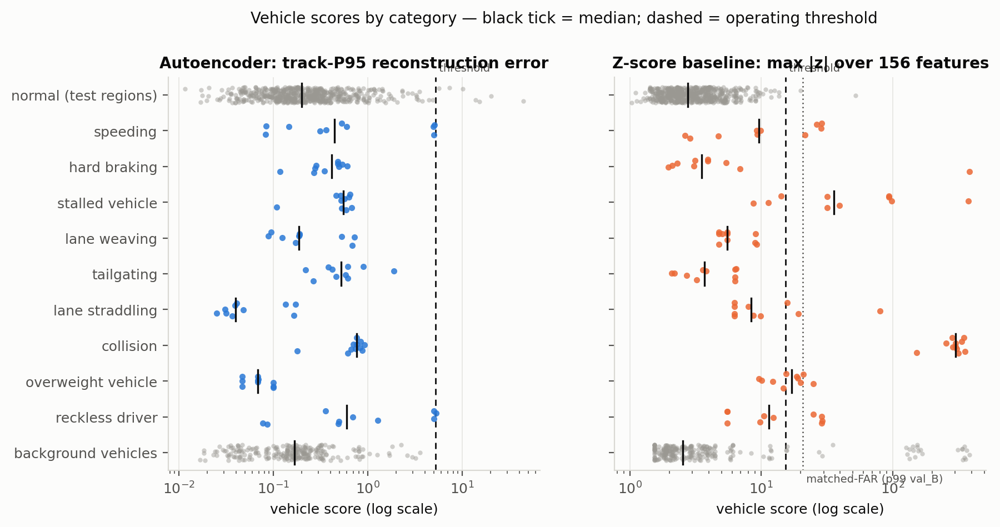

Figure 2 — Vehicle scores by category. The autoencoder separates only the severe speeding and reckless runs from the normal population; the Z-score model separates collisions, stalls, speeding and (through truth-derived DAS features) overweight and straddling vehicles.

The Z-score baseline is far ahead. At its shipped threshold it flags 70 % of the published anomaly vehicles and 36 % of the severity vehicles at a 0.3 % false-alarm rate on held-out normal vehicles — and 10.7 % of the background vehicles of anomaly scenarios (vehicles that stop behind a stalled or crashed car). The autoencoder's ranking is barely above chance (AUROC 0.60); at its 1 % operating point it flags one vehicle of 91.

### 4.2 Recall versus severity

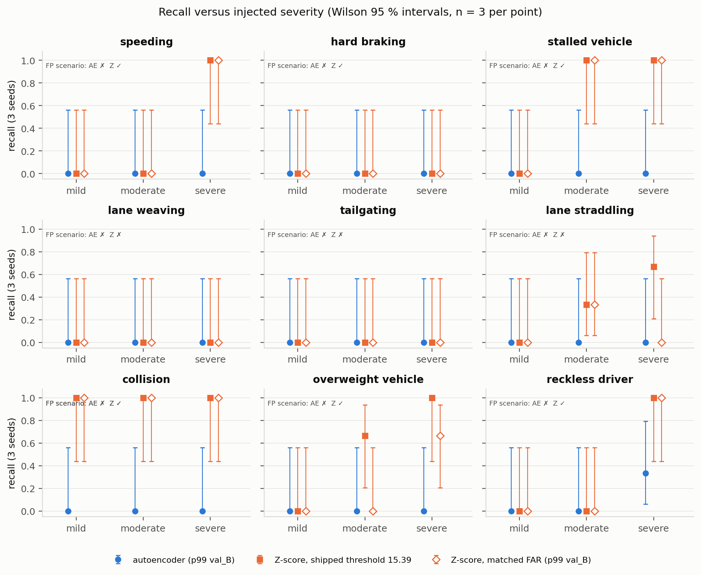

Figure 3 — Recall per anomaly type and level (3 seeds per point, Wilson intervals). The published scenario of each type is annotated (AE / Z).

Table 3 — median vehicle score per type and level (AE: reconstruction error; Z: max |z|) and detections at the operating thresholds. n = 3 per cell.

| Type | Level | AE score | AE det. | Z score | Z det. |
|---|---|---|---|---|---|
| speeding | mild / moderate / severe | 0.08 / 0.36 / 5.01 | 0 / 0 / 0 | 2.9 / 9.4 / 28.6 | 0 / 0 / 3 |
| reckless driver | mild / moderate / severe | 0.09 / 0.49 / 5.01 | 0 / 0 / 1 | 5.5 / 10.5 / 29.0 | 0 / 0 / 3 |
| hard braking | mild / moderate / severe | 0.27 / 0.48 / 0.54 | 0 / 0 / 0 | 3.1 / 5.4 / 2.3 | 0 / 0 / 0 |
| stalled vehicle | 4 / 10 / 30 s | 0.63 / 0.57 / 0.52 | 0 / 0 / 0 | 11.3 / 32.0 / 94.0 | 0 / 3 / 3 |
| lane weaving | mild / moderate / severe | 0.09 / 0.19 / 0.68 | 0 / 0 / 0 | 5.5 / 4.8 / 9.0 | 0 / 0 / 0 |
| lane straddling | mild / moderate / severe | 0.04 / 0.04 / 0.05 | 0 / 0 / 0 | 6.2 / 9.9 / 15.8 | 0 / 1 / 2 |
| tailgating | mild / moderate / severe | 0.62 / 0.46 / 0.61 | 0 / 0 / 0 | 3.8 / 3.6 / 6.3 | 0 / 0 / 0 |
| collision | mild / moderate / severe | 0.83 / 0.71 / 0.76 | 0 / 0 / 0 | 286 / 307 / 301 | 3 / 3 / 3 |
| overweight vehicle | 20 / 30 / 40 t | 0.07 / 0.07 / 0.07 | 0 / 0 / 0 | 10.1 / 15.5 / 20.9 | 0 / 2 / 3 |

The autoencoder's score is a monotone function of severity for the four types that change the kinematics — speeding (0.08 → 0.36 → 5.0), reckless driving, hard braking (0.27 → 0.54) and weaving (0.09 → 0.68) — and flat for the others (Figure 4). Only the top speeding level, at twice the limit, reaches the 99th percentile of normal vehicles (5.20); the 1.4× level scores like a typical normal vehicle. The Z-score model detects what its features were written for: `kin_stop_event_count` fires on every collision and every stall of ≥ 10 s, `cov_high_speed_gap_frac` on the 2× speeders, and the truth-derived DAS features (`das_W_est_kg`, `cov_das_amplitude_std`, `das_snr_low_frac`, `cov_das_lateral_change_rate_max`) on overweight and straddling vehicles. Neither detector sees hard braking (peak 6 m/s² against a normal IDM limit of 4 m/s²), weaving (3 m amplitude against a normal drift clamped at ±1.8 m) or tailgating, whose realised headways (0.7–0.9 s) overlap normal dense traffic.

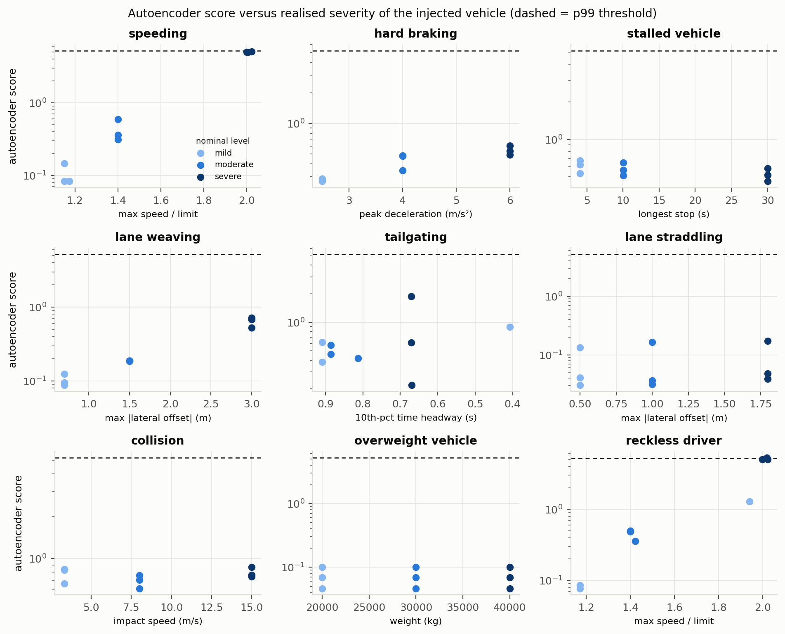

Figure 4 — Autoencoder vehicle score against the *realised* severity of each run (dose–response). Dashed line: p99 threshold.

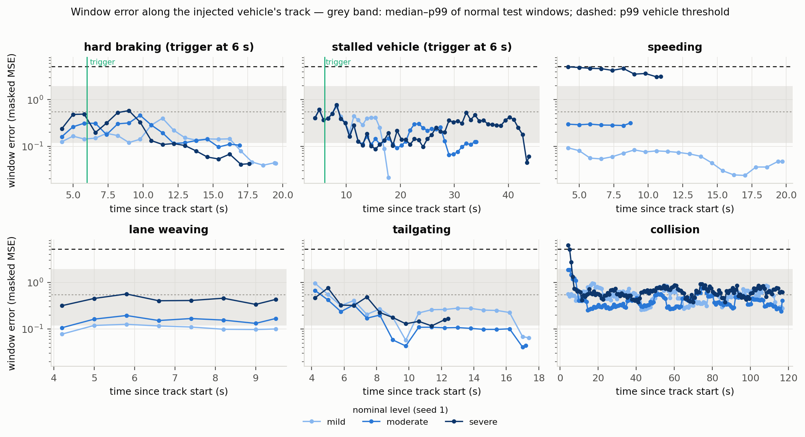

Figure 5 — Window error along the injected vehicles' tracks (seed 1). The braking and stall triggers at 6 s raise the error for a few seconds, but within the band of normal windows (grey: median to 99th percentile of normal test windows).

### 4.3 False alarms and DAS noise

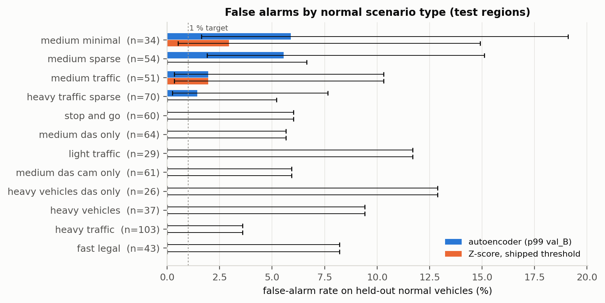

Figure 6 — False-alarm rate per normal scenario type on the test regions.

The autoencoder's 7 false alarms at the 1 % operating point come from the sparse-coverage types (medium_minimal 5.9 %, medium_sparse 5.6 %, heavy_traffic_sparse 1.4 %) and medium_traffic (2.0 %); every full-coverage type other than medium_traffic has zero. Sparse coverage makes the fused track drift while the filter coasts, and those windows are the hardest to reconstruct. The Z-score model's two false alarms are one medium_minimal and one medium_traffic vehicle (its training excluded the medium_minimal type).

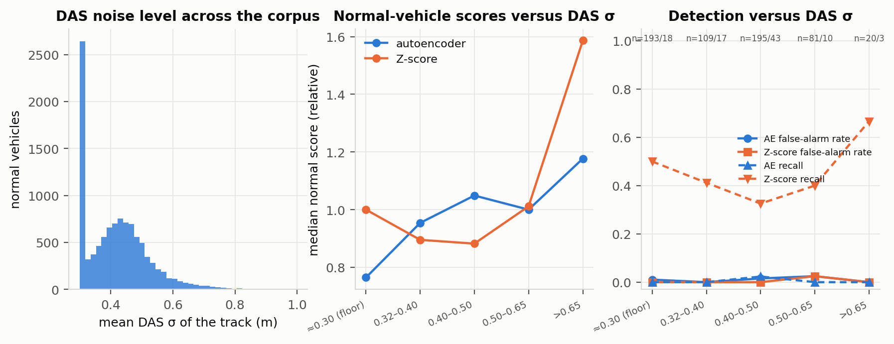

Figure 7 — Results stratified by the track's mean DAS σ (0.30 m floor to > 0.65 m). Neither detector's normal-score level nor its false-alarm rate depends on the DAS noise level in this range; the recall differences between strata reflect which anomaly types fall into them (the 2× speeders are light, fast cars far from the fibre, σ ≈ 0.4–0.5 m).

The DAS σ of a track varies from the 0.30 m floor (heavy vehicles close to the fibre) to about 0.8 m, which is the only DAS-noise variation available without changing the simulator (`docs/DESIGN_phase2_plan.md` §3). Across the five strata the median normal score of the autoencoder varies from 0.19 to 0.29 and its false-alarm rate from 0 % to 2.5 % (n = 20–195 per stratum, all intervals overlapping); the Z-score model's from 2.8 to 5.0 and 0 % to 2.5 %. Within this range the fused track is dominated by the camera (σ ≈ 0.16 m) and by the filter's smoothing, so the DAS noise level is not what limits either detector.

### 4.4 Sensitivity study

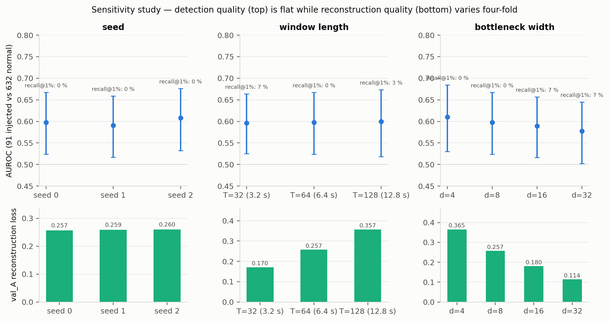

Figure 8 — AUROC (bootstrap 95 % intervals) and recall at 1 % FAR across seeds, window lengths and bottleneck widths.

Table 4 — the training study. All runs use the same data, split, normalisation and protocol; scores are evaluated on the same 91 + 632 vehicles. Epochs = epochs run (best epoch); val loss = masked MSE of normal val_A windows; "p99 op." = threshold at the 99th percentile of val_B, with the false-alarm rate and recall it gives on the test regions.

| Run | T | d | seed | params | epochs | val loss | AUROC [95 % CI] | AUPRC | recall @ 1 % / 5 % FAR | p99 threshold | FAR / recall at p99 |
|---|---|---|---|---|---|---|---|---|---|---|---|
| primary | 64 | 8 | 0 | 132,718 | 90 (79) | 0.257 | 0.598 [0.52, 0.67] | 0.193 | 0 % / 8 % | 5.20 | 1.1 % / 1.1 % |
| seed 1 | 64 | 8 | 1 | 132,718 | 74 (63) | 0.259 | 0.591 [0.52, 0.66] | 0.191 | 0 % / 9 % | 5.19 | 1.3 % / 1.1 % |
| seed 2 | 64 | 8 | 2 | 132,718 | 72 (61) | 0.260 | 0.608 [0.53, 0.68] | 0.203 | 0 % / 9 % | 5.13 | 1.1 % / 4.4 % |
| T = 32 (3.2 s) | 32 | 8 | 0 | 124,014 | 89 (78) | 0.170 | 0.597 [0.53, 0.66] | 0.197 | 7 % / 8 % | 6.02 | 0.8 % / 0 % |
| T = 128 (12.8 s) | 128 | 8 | 0 | 150,126 | 84 (73) | 0.357 | 0.600 [0.52, 0.67] | 0.219 | 3 % / 8 % | 6.56 | 0.8 % / 0 % |
| d = 4 | 64 | 4 | 0 | 124,522 | 70 (59) | 0.365 | 0.610 [0.53, 0.68] | 0.231 | 0 % / 16 % | 7.51 | 1.1 % / 0 % |
| d = 16 | 64 | 16 | 0 | 149,110 | 99 (88) | 0.180 | 0.589 [0.52, 0.66] | 0.190 | 7 % / 9 % | 4.26 | 0.9 % / 6.6 % |
| d = 32 | 64 | 32 | 0 | 181,894 | 100 (97) | 0.114 | 0.577 [0.50, 0.64] | 0.204 | 7 % / 19 % | 3.64 | 0.9 % / 6.6 % |
| first design: unbounded decoder, 8 targets | 64 | 8 | 0 | 133,168 | 84 (73) | 0.585 | 0.369 [0.24, 0.52] | 0.013 | 0 % / 0 % | 7.35 | 0.8 % / 0 % |

The result is robust to every knob of the study. Seeds move the AUROC by ±0.01 (0.591–0.608), well inside the bootstrap interval; the window length (3.2 s to 12.8 s) leaves it at 0.60; the bottleneck width from 4 to 32 moves it from 0.610 to 0.577 while the normal reconstruction loss improves more than three-fold (0.365 → 0.114). A d = 32 model reconstructs normal windows far better and also reconstructs the anomalies: its median stall and braking vehicles score 0.13 and 0.06 against 0.55 and 0.41 for d = 8, so the wider code lowers the threshold (3.64 against 5.20) and the anomaly scores together; at its p99 operating point it flags exactly the six 2× speeding and reckless vehicles and nothing else, where d = 8 flags one of them and d = 4 none. The first design — an unbounded decoder reconstructing all eight value channels — is the informative negative control: its AUROC of 0.37 is *below* chance because the noise-dominated `a_lon` and `v_lat` channels contribute an irreducible error that is smaller for the smooth anomalous tracks (a stalled car, a straddling car on a straight road) than for typical normal traffic, and because the unbounded decoder reproduces a vehicle at twice the speed limit exactly. Bounding the decoder to the normal range and dropping the two derivative channels from the targets is what lifts the model to 0.60; nothing else in the study moves it.

### 4.5 What the autoencoder learns

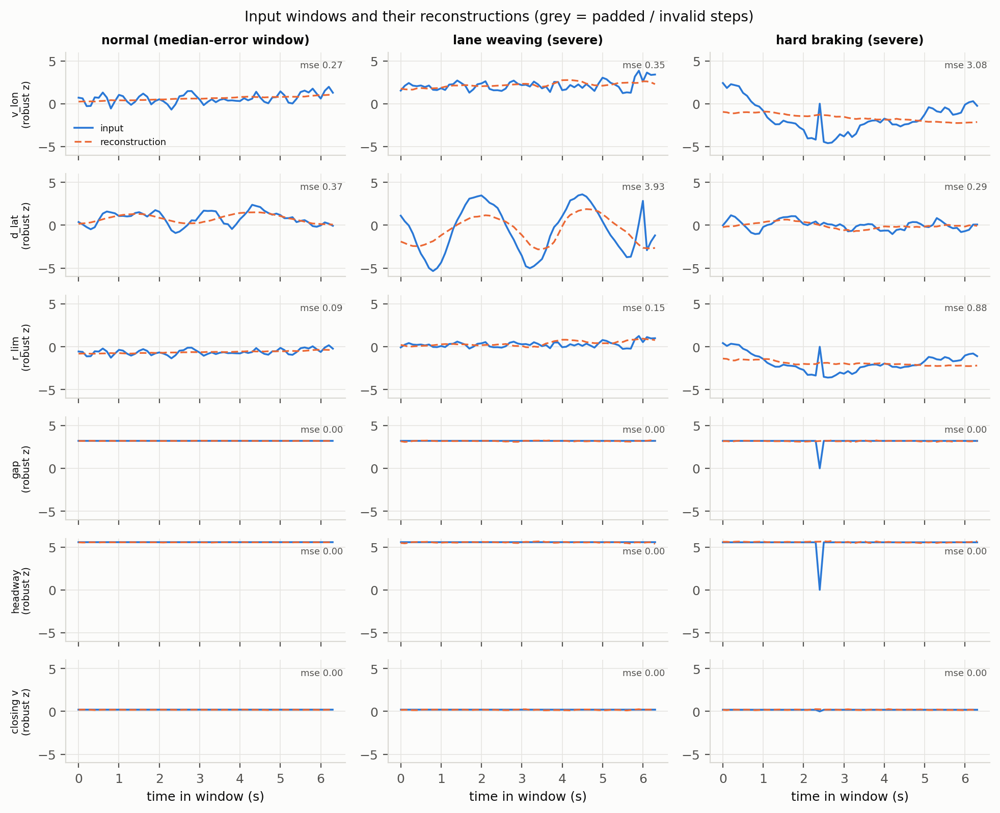

Figure 9 — Input windows (blue) and their reconstructions (orange, dashed) for a median-error normal window, a severe weaving window and a severe braking window.

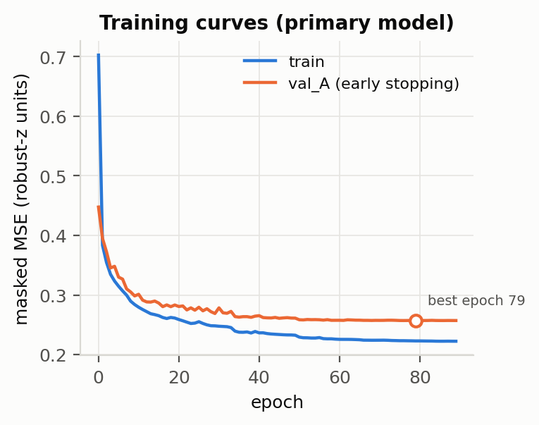

Figure 10 — Training and early-stopping curves of the primary model.

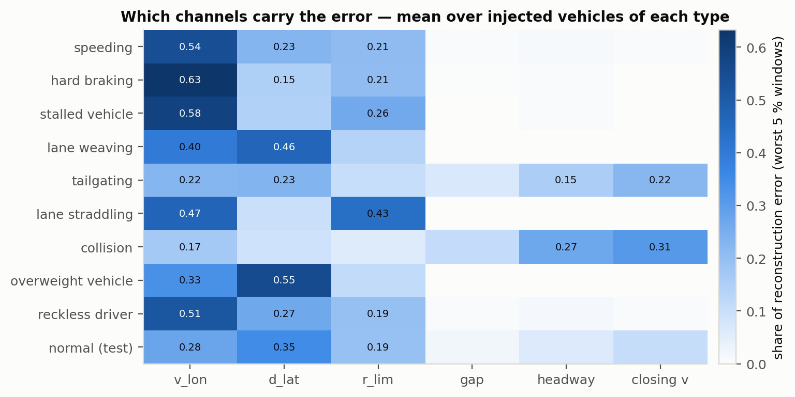

Figure 11 — Share of the reconstruction error carried by each target channel in the worst 5 % of windows, per anomaly type and for normal test vehicles.

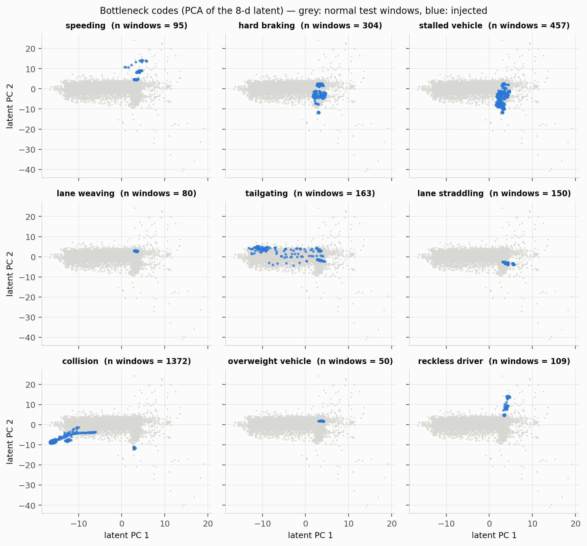

Figure 12 — The 8-d bottleneck codes projected on their first two principal components: normal test windows (grey) and the windows of injected vehicles of each type (blue).

The reconstructions explain the numbers. With eight code dimensions for six channels of 64 steps, the decoder output is close to a per-channel window mean with a gentle slope: a braking ramp from +2 to −4 standardised units is reconstructed as a flat line at their average, a 3 m weave as a damped, lagged oscillation. The error therefore measures within-window variation, which many normal windows — a vehicle pulling away from a queue, a leader appearing, a coasting track under sparse coverage — have in the same amount as the injected events. Attribution (Figure 11) is consistent: the error of injected vehicles sits on `v_lon` (braking, stalls, speeding), `d_lat` (weaving, straddling), `r_lim` and the leader channels (tailgating, collisions), i.e. in the right channels, but at the wrong magnitude relative to normal windows. In the latent space the injected windows lie inside the cloud of normal codes; only the severe speeders form a separate cluster (top-left in the speeding panel of Figure 12).

### 4.6 The real Klausner track

Figure 13 — The one real DAS track of the Final Project (a bus at a bus stop, 41.8 s, 86 DAS picks and 39 camera detections) through the same pipeline.

The track runs through the pipeline unchanged: the bus decelerates, stands for ≈ 17 s and pulls away. The autoencoder's window error is highest in the first seconds (noisy DAS-only velocity) and at departure, but stays below the p99 threshold (track score 2.15 < 5.20), i.e. the AE does not flag a normal bus stop; the Z-score model flags the same track (max |z| = 27.5, top feature `kin_jerk_mean_abs_mps3`), driven by the real DAS velocity noise, which is far larger than the simulated one (`a_lon` reaches ±50 m/s²). One unlabeled track cannot validate either detector; it does show the direction in which the simulator is optimistic.

## 5. Discussion

**Why reconstruction error fails here.** Three effects compound. (1) *Envelope*: the simulator's normal driving already contains stops (stop-and-go scenarios), braking up to 4 m/s², lateral drift up to ±1.8 m and close following (IDM headway 1.2 s), so mild and moderate levels of most types are inside the normal envelope by construction — a fact established in Phase 1 and confirmed by both detectors' zero recall on braking, weaving and tailgating. (2) *Scale*: a 6.4 s window sees a 2 s braking ramp or a few seconds of a stop, but not that the stop lasted 30 s or that the vehicle stopped where nobody else does; the Z-score model's winning features (`kin_stop_event_count`, stop duration, `cov_high_speed_gap_frac`) are track-level statistics. (3) *Capacity*: the bottleneck. With d = 8 the model encodes little beyond window means and treats all within-window variation as error, so the normal tail is wide; the sensitivity study shows the dilemma directly — widening the code from 4 to 32 dimensions cuts the normal reconstruction loss from 0.365 to 0.114 and reconstructs the anomalies just as well, so the AUROC stays between 0.58 and 0.61 whatever the capacity, and neither shorter nor longer windows change it. Bounding the decoder to the normal range is what makes the 2× speeders detectable at all — a reconstruction-error detector with an unbounded decoder reproduced them perfectly.

**What the baseline exploits.** Of its seven detected categories, two (overweight, straddling) rest on features computed from simulator ground truth — DAS amplitude, weight estimate, true lateral offset — which the deep model was forbidden to use, and would not exist in a real deployment in that form. Its remaining detections are stop counts and the fraction of time above the limit, i.e. simple, interpretable track-level rules. Its 10.7 % flag rate on background vehicles (cars queuing behind the stalled or crashed vehicle) and its false alarm on the real bus stop show the flip side of stop counting.

**Limitations.** The exported trajectories inherit truth in three places (oracle-aided association, truth-seeded initialisation, noise-free camera/GPS velocity), so both detectors see cleaner tracks than a real system would; the comparison is fair but absolute numbers are optimistic. The severity study has 3 seeds per cell; the Wilson intervals at n = 3 are wide, and its tailgating levels are not separated in realised headway. The quality gate removes 3.3 % of normal tracks; results without it are reported (AUROC 0.578 / 0.879) and do not change the conclusion. Only one real track exists.

**What would help.** Within the reconstruction paradigm: a track-level pooling of window errors that keeps event duration (the stall and collision runs have the right error in the right channel for the wrong number of windows), longer windows or a hierarchical model, and a training objective that forces the code to model dynamics rather than means (masked or predictive reconstruction). Outside it: the truth-free analogue of the baseline's best features — the fraction of time above the limit and stop duration are computable from the same channels, and a hybrid of such statistics with the AE's channel-wise error would likely dominate both.

## 6. Reproducibility

Everything is in `DL/` (README, `docs/PIPELINE.md`). The 13 Final-Project code files and 323 data files it depends on are vendored byte-for-byte with SHA-256 hashes (`docs/CODE_PROVENANCE.md`); a test re-hashes them and asserts that no DL code imports the parent project or references paths outside `DL/`. The pipeline is nine numbered scripts, all resumable and seeded (`scripts/run_all.sh`): vendoring, import of the exports, severity simulation, dataset construction, training (the eight configurations of the study), scoring, baseline, evaluation, figures; 38 tests cover provenance, isolation, baseline equivalence, geometry, channels, model, dataset integrity, the quality gate, the severity variants and runner determinism. The data import and tests were run on the author's machine; the severity simulations, training and evaluation were run on a 2-core Linux container (torch 2.14 CPU) and their outputs (`data/generated/severity`, `experiments/`, `outputs/`) copied back; the runner is deterministic given its seed (identical exported tracks across repeated runs), and the same seeds reproduce the figures.

## References

1. Final Project report and README of SimStudio (Sapir, Zini, Shevo, 2026), vendored design documents in `docs/`.
2. Approved proposal "Deep DAS" and the course guidelines (Deep Learning, TAU, 2026).
3. Treiber, M., Hennecke, A., Helbing, D. (2000). Congested traffic states in empirical observations and microscopic simulations. *Physical Review E* 62, 1805 — the intelligent driver model.
4. Sakurada, M., Yairi, T. (2014). Anomaly detection using autoencoders with nonlinear dimensionality reduction. *MLSDA workshop*.
5. Ruff, L. et al. (2021). A unifying review of deep and shallow anomaly detection. *Proceedings of the IEEE* 109(5).
6. Audibert, J. et al. (2020). USAD: unsupervised anomaly detection on multivariate time series. *KDD*.
7. The references cited in the Final Project README for DAS traffic sensing ([1]–[2] there), including the supervisor group's CNN work on DAS traffic data.
