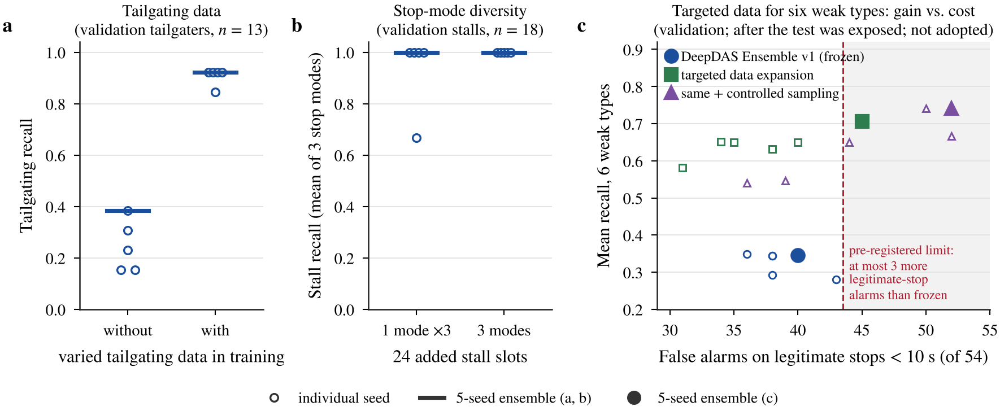

# Study 04: Stop-mode diversity (the selection of DeepDAS Ensemble v1)

> **Research question Q2** ([research index](../README.md)): how did training stability and data diversity affect detection?
>
> **Status:** completed; the diversity arm was selected and frozen as **DeepDAS Ensemble v1**, the final model. **Data role:** validation.

## Summary

**What we wanted to find out.** After the new tailgating data was added, the stalled development case was missed. We asked three things:

- Was it a sampling problem, or an encoder problem?
- Was a stop mode missing from training?
- Do diverse stop modes generalise better than more copies of one mode?

**What was compared.**

1. **Two exposure experiments** on the recipe of study 03: type-balanced anomaly sampling, and a frozen encoder with head-only training.
2. **Two arms** that add the same 24 stall slots (same regions, vehicles, routes, stop locations, sensing and speeds): one stop mode repeated three times, or three different stop modes. Each arm has five seeds.

**Held constant:** everything except the stop mode, including the matched controls and the legitimate stops. The replacement rule was fixed before training.

**Data and its role.**

- **The stall and stop set:** training slots and a stall validation set in selection regions (18 stalls in 3 modes, 6 legitimate stops, 6 controls).
- **Also used:** the original validation set.
- **Role:** validation. The development cases were reported only after freezing.

*Figure, panel (b).* Recall on the 18 validation stalls (mean over the three stop modes) when the 24 added stall slots repeat one stop mode or cover three, per seed (open) and for the five-seed ensemble (bar).

**Result.**

- **Exposure experiments:** neither qualified. Macro recall on the original validation set was 0.603 with balanced sampling and 0.205 with the frozen encoder, against 0.714 for the reference; the frozen encoder also exceeded the false-alarm limit.
- **Stop modes:**
  - Both ensembles detect 18/18 validation stalls. Per seed, repetition gives 0.93 ± 0.15 and diversity 1.00 ± 0.00; one repeated-mode seed falls to 0.67.
  - Both arms pass the four pre-registered conditions and tie on validation macro recall and stall recall, so validation AP decides: 0.781 against 0.751.

**Decision.**

- The diversity ensemble is selected and frozen as DeepDAS Ensemble v1, with τ = 1.9726181803233118, before the final test.
- After freezing it detects 8 of the 9 development cases; overweight is missed at score 1.865.

**What this does not show.**

- **Legitimate stops.** The model flags them (4 of 6 here, 40 of 54 in study 05). The issue stays open.
- **Independence.** All comparisons here are on validation data.

**Code, data and reproduction.**

- **Model:** [`models/deepdas_ensemble_v1/`](../../models/deepdas_ensemble_v1/) (frozen).
- **Data:** `data/processed/anomaly_sets/stalls_and_stops/`, `data/simulation_plans/stalls_and_stops/` (data package).
- **Records:** [`records/exp12_balanced_vs_frozen_20261008_RESULTS_EXP12.md`](records/exp12_balanced_vs_frozen_20261008_RESULTS_EXP12.md), [`records/stall_diversity_20261008_RESULTS_STALL.md`](records/stall_diversity_20261008_RESULTS_STALL.md), [`records/stall_diversity_20261008_per_seed_and_ensemble.csv`](records/stall_diversity_20261008_per_seed_and_ensemble.csv).
- **Reproduction:**
  - `scripts/train_ensemble.py` retrains the five checkpoints bit-exactly on the build platform (`docs/REPRODUCIBILITY.md`).
  - `scripts/reproduce_validation.py` regenerates the validation scores of the final model.
  - The quantity arm and the exposure experiments are archived.

More figures: [figure gallery](../../figures/README.md) · All studies: [research index](../README.md) · Report map: [docs/QUESTION_MAP.md](../../docs/QUESTION_MAP.md)

---

## Full record

**Status:** completed. The diversity arm (internal `E_stall_diversity_ENSEMBLE`) was selected and became **DeepDAS Ensemble v1**.

**Data role:** validation only. The selection used the original validation set and the new stall validation set (`stallval`). The development cases were reported only after the checkpoints and thresholds were fixed.

## Background: the stalled-vehicle regression
The ensemble of study 03 (internal `C_new`) missed the stalled development case. A read-only diagnosis was run before any new training (`records/stalled_regression_diag_*`, `records/exp12_*` plan).

**What the diagnosis found:**
- **The original stalled vehicle never moves.** Its tracked speed is noisy and non-zero, so its input never looks like a clean stop. The training stalls all **move → stop 30 s → move**.
- **The case was already fragile:** 2/5 seeds detected it before the tailgating data, 1/5 after.
- **Tailgating took about 60 % of the anomaly draws,** so each of the other types was drawn about 2.4× less often per epoch (94 instead of 226).
- **Encoder drift:** before supervised training, the encoder placed the vehicle at the 97th percentile of the training-stall direction. After fine-tuning it fell to the 20th–97th, depending on the seed.

### Two exposure experiments (pre-registered; `records/exp12_*`)
- **EXP1 – type-balanced anomaly sampling.** Each anomaly slot first draws a type uniformly, then a vehicle.
- **EXP2 – frozen encoder, head-only training.**

| | Reference (C_new) | EXP1 | EXP2 |
|---|---|---|---|
| Macro recall, original validation set (9 types) | 0.714 | 0.603 | 0.205 |
| False alarms, val_A normals | 1.14 % | 1.45 % | 1.52 % (> limit) |
| Tailgating validation | 12/13 | 12/13 | 11/13 |
| Qualifies | — | no | no |

- **Conclusion of this step:** neither balancing nor freezing the encoder helps.
- Exposure alone does not fix the stall miss: EXP1 raised stall exposure but added **no new stop mode**.
- The supervised fine-tuning of the encoder is necessary: EXP2 lost most types.

## Hypothesis
The model misses stalls that do not look like the training stalls because training lacks the other stop modes:
- vehicles standing from the start;
- vehicles that stop and never drive on.

Training also lacks these stops **as seen through the noisy tracker**. Diverse stall modes generalise better than more examples of the one existing mode.

## Method (pre-registered; `records/stall_diversity_*`)
**Two arms, with the same amount of added data.** Both keep all of the training data of study 03 and add the same 24 stall *slots*. A slot is defined by its region, vehicle, route, stop location, sensing condition and speed. The arms differ **only** in the stop mode:

| Slot group (8 each) | Quantity arm | **Diversity arm** |
|---|---|---|
| A | move → stop 30 s → move (MSM) | MSM (the same runs) |
| B | MSM | stands still from t = 0 (START) |
| C | MSM | moves, then stops until the end (STOP_END) |

**Sensing balance.** Every stop is on a DAS-covered segment. Each training region has one DAS-only slot and one slot with combined DAS + camera coverage, so the sensor mix cannot act as a label cue.

**Normals added (identical in both arms):** for every slot,
- a **matched control** run that drives through the stop location without stopping;
- a **legitimate stop**: braking at 2 m/s², standing 3 or 5 s, and driving on. Verified only if the truth shows a 1–10 s stop, peak deceleration < 4 m/s², and no collision.

**Stop rule.** A stop of ≥ 10 s is a stall (anomalous); a stop of 1–10 s is legitimate (normal).

**Labels.** Each label is verified on the simulator truth per mode. Unverified runs and queued background vehicles are excluded and counted.

**New stall validation set (`stallval`).** It is in val_A regions, disjoint from the training regions, and contains:
- 18 stalls (6 per mode, half of them DAS-only);
- 6 legitimate stops and 6 controls.

All of it is in `data/processed/anomaly_sets/stalls_and_stops/`.

**Training.** The recipe of study 03, 5 seeds, checkpoint by validation AP on the **same validation set as before**. `stallval` is **not** used for checkpoint selection.

**Replacement rule (fixed before training).** An arm replaces the current candidate only if all of these hold:
1. stallval macro recall over the 3 modes is strictly higher;
2. macro9 is strictly higher (9-type validation recall; the stall entry pools the original and the stallval stalls);
3. tailgating validation ≥ 12/13;
4. false alarms on val_A ≤ 1.5 %.

If both arms pass, the higher macro9 wins; ties go to the higher stallval macro, then to validation AP.

**Disclosed erratum at launch.** The first launch included backgrounds from arm-specific runs, contrary to the plan. It was stopped after 3 epochs, never evaluated, and relaunched from scratch with a one-line filter fix (`records/*ADDENDUM*`).

## Results (validation; each ensemble at its own val_B P99)

| | Reference (C_new) | Quantity | **Diversity** |
|---|---|---|---|
| Stallval macro recall (3 modes) | 0.667 | 1.000 | **1.000** |
| Stallval START / STOP_END / MSM | 2/6 · 5/6 · 5/6 | 6/6 · 6/6 · 6/6 | **6/6 · 6/6 · 6/6** |
| macro9 | 0.680 | 0.714 | **0.714** |
| Tailgating validation | 12/13 | 12/13 | **12/13** |
| False alarms, val_A normals | 1.14 % | 1.07 % | **1.07 %** |
| Validation AP | 0.766 | 0.751 | **0.781** |
| Stallval legitimate stops flagged (reported, not gating) | 4/6 | 5/6 | 4/6 |
| Per-seed stallval macro (mean ± std) | 0.78 ± 0.23 | 0.93 ± 0.15 | **1.00 ± 0.00** |

**Decision.**
- Both arms pass all four conditions.
- macro9 and stallval macro are tied, so validation AP decides → **the diversity ensemble is selected**.
- It was frozen as DeepDAS Ensemble v1, with its threshold 1.9726181803233118 (P99 of the ensemble score on val_B).
- **Development cases** (reported after freezing): **8/9**. The stalled case is detected again; overweight is missed, at score 1.865.

**Determinism check.** The frozen reference checkpoints were re-scored and matched their saved validation scores (maximum difference ≤ 5.7e-6).

## Conclusions
1. **Diversity of stop modes, not quantity, makes stall detection robust across seeds.** Every diversity seed detected all 18 validation stalls; the quantity arm did not.
2. **The legitimate-stop cost is visible in this study and remains open.** The legitimate stops are a normal class that the model often flags (4/6 here, 40/54 on the larger set of study 05).
3. **What became DeepDAS Ensemble v1** is the diversity ensemble: 5 seeds, checkpoints chosen by validation AP, frozen val_B standardisation, and the P99 ensemble threshold.

## Contents
| Path | Content |
|---|---|
| `records/` | The stalled-regression diagnosis and the training composition, the EXP1/EXP2 plan and results, the stall plan with its addendum, results, selection record, per-seed table and exposure summary, all verbatim |
| `../../models/deepdas_ensemble_v1/` | The selected model (frozen) |
| `../../data/processed/anomaly_sets/stalls_and_stops/`, `../../data/simulation_plans/stalls_and_stops/` | The stall and stop set: training slots and stallval |
| `src/deepdas/train/supervised.py`, `scripts/train_ensemble.py` | The training recipe, which reproduces the frozen checkpoints (see `docs/REPRODUCIBILITY.md`) |
