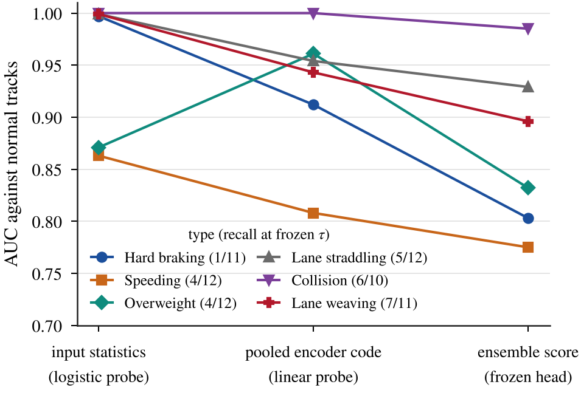

# Study 06: Diagnosis of the weak anomaly types

## At a glance

| | |
|---|---|
| **Research question** | Where is the information about the six weak types lost: in the input, in the encoder, or in the head? |
| **What was compared** | For each weak type: the AUC against normal tracks of simple input statistics (logistic probe), of the pooled encoder code (linear probe), and of the frozen ensemble score. |
| **Data** | The final-test tracks <b>after</b> the single final-test evaluation, used as exposed development data. Read-only: nothing was trained or changed. |
| **Result** | Simple input statistics separate the weak types from normal tracks (probe AUC 0.86–1.0), and the pooled encoder code keeps most of this (0.81–1.0). The ensemble score is lower (0.78–0.99). The head was trained on about four examples per type. |
| **Conclusion and limits** | The loss is after the encoder, in the head and its few training examples. This motivated study 07. As post-hoc diagnosis on exposed data, it is not evidence for any model's performance. |
| **Reproduce** | Read-only diagnosis; its tables are in <code>records/</code>. The figure is redrawn from <code>records/weak_types_diag_20261010_results_information_flow_by_type.csv</code> by <code>figures/scripts/make_study_figures.py</code>. |

AUC against normal tracks at three stages, per weak type; in brackets, the final-test recall at the frozen threshold.

More figures: [figure gallery](../../figures/) · All studies: [research index](../)

---

## Full record

**Status:** completed. This was a read-only diagnosis: nothing was trained, simulated, re-thresholded or changed. It motivated study 07.

**Data role: exposed final-test data.** The diagnosis used the final-test runs after the single final-test evaluation of DeepDAS Ensemble v1. From this point on those runs count as **exposed development data**. They are not used as evidence for any later model. The final-test result of DeepDAS Ensemble v1 (`results/final_test/`) was computed before this study and is unaffected.

## Question and hypothesis
In the final test, DeepDAS Ensemble v1 detected stalls (12/12) and tailgating (11/11) reliably. Six types were weak:

| Type | Detected |
|---|---|
| Hard braking | 1/11 |
| Speeding | 4/12 |
| Overweight | 4/12 |
| Lane straddling | 5/12 |
| Collision | 6/10 |
| Lane weaving | 7/11 |

**Hypothesis.** The weak types fail in the **head and its training data**, not in the representation. The distinguishing physics is present in the input channels and reaches the encoder's pooled codes, but the head never learned to use it.

## Method
Five measurements per type, following the flow of information:

| # | Stage | Measurement |
|---|---|---|
| 1 | Truth | Realised strength of each anomaly, from the simulator truth |
| 2 | Input | AUC of simple statistics of the model's own input channels. Also a cross-validated logistic probe on 13 such statistics, grouped by run |
| 3 | Encoder | Cross-validated linear probe on the pooled 16-d code of each frozen seed. Also on the initial autoencoder |
| 4 | Head | AUC of the frozen ensemble score; recall at the frozen threshold |
| 5 | Training data | Count, parameters and ranges of the training examples, compared with the test anomalies and the normals |

**Additional checks:**
- **Dilution check:** the frozen models scored on an 8 s crop around the event, compared with normals cropped around their own worst moment.
- **Collision check:** the score with the post-impact part removed.

## Results

| Type | Input probe AUC | Encoder probe AUC | Ensemble score AUC | Recall at threshold |
|---|---|---|---|---|
| Hard braking | 0.997 | 0.91 | **0.80** | 1/11 |
| Speeding | 0.86 | **0.81** | **0.78** | 4/12 |
| Overweight | 0.87 | 0.96 | **0.83** | 4/12 |
| Lane straddling | 0.999 | 0.95 | 0.93 | 5/12 |
| Collision | 1.0 | 1.0 | 0.985 | 6/10 |
| Lane weaving | 0.999 | 0.94 | 0.90 | 7/11 |
| *Tailgating (reference)* | 0.91 | 1.0 | 1.0 | 11/11 |

**Training data.** Each weak type had **4 training vehicles**, from a single fixed design, out of 105 positives: 3.8 % of positive draws each.
- For comparison, tailgating had 49 vehicles (47 %) and stalls 28 (27 %).
- The validation set used for checkpoint selection had only 2 vehicles per weak type.

**Per-type findings:**

**Hard braking.** The tracker-derived acceleration a_lon has a noise floor comparable to the event: the median of the minimum a_lon of normal tracks is −7.5 m/s².
- The only training design brakes at t = 6 s, at the start of the track.
- Legitimate stops, labelled normal, look like it apart from the dwell time.
- Scoring an event crop does not help, so pooling dilution is not the cause.

**Speeding.** The simulator's own normal traffic exceeds the limit: 26 % of training normal tracks have a speed-ratio p90 > 1.15.
- Two of the four training examples are extreme (×2.4), partly speed-limit artefacts.
- The score does not follow the speed ratio.

**Overweight.** The DAS amplitude separates well (AUC 0.945) and the encoder keeps it (0.96). This is the largest encoder→head loss.
- The training examples sit above almost every test anomaly, so the head learned a boundary that is too high.
- One test track has no DAS amplitude at all, a coverage limit.

**Straddling, weaving, collision.** These are ranked well but sit just below the threshold, so the problem is **margin**.
- Straddling: map-matching flips lanes for a vehicle exactly on the line.
- Collision: part of the signal is the long stop after impact. With the track cut 2 s after impact, 5/10 stay above threshold, against 6/10 on the full track.

## Conclusions
1. **The hypothesis holds.** For all six types the information is in the input and reaches the encoder (probe AUC ≥ 0.81, ≥ 0.91 for five of six). The loss happens after the encoder: too few homogeneous head-training examples and a small threshold margin.
2. **The types differ in how much data alone could help:**
   - Overweight, straddling, weaving and collision are good candidates for targeted data.
   - Speeding is partly limited by the overlap of mild speeding with the simulator's normal speed tail.
   - Hard braking is the least promising, because of the a_lon noise floor and the legitimate-stop look-alikes.
3. **These are indications, not achievable scores.** The probes are cross-validated on the same exposed data with 10–12 positives per type.
4. **Next step.** A targeted, diverse data expansion with matched normal controls, and a strict no-regression rule, was proposed and approved → study 07.

## Contents
| Path | Content |
|---|---|
| `records/` | The full diagnosis and proposed plan (verbatim), and its tables: information flow by type, training inventory and track statistics, train vs test ranges, dilution crops and summary, the hard-braking event window, and truth realisation in the final test and in the cross-region set |

The per-track table of the final test is not duplicated here. The final-test scores of DeepDAS Ensemble v1 are in `results/final_test/scores_dl_tracks.csv`.
