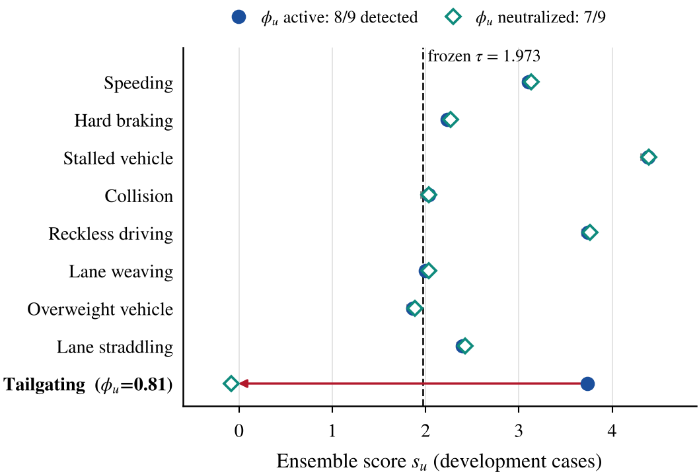
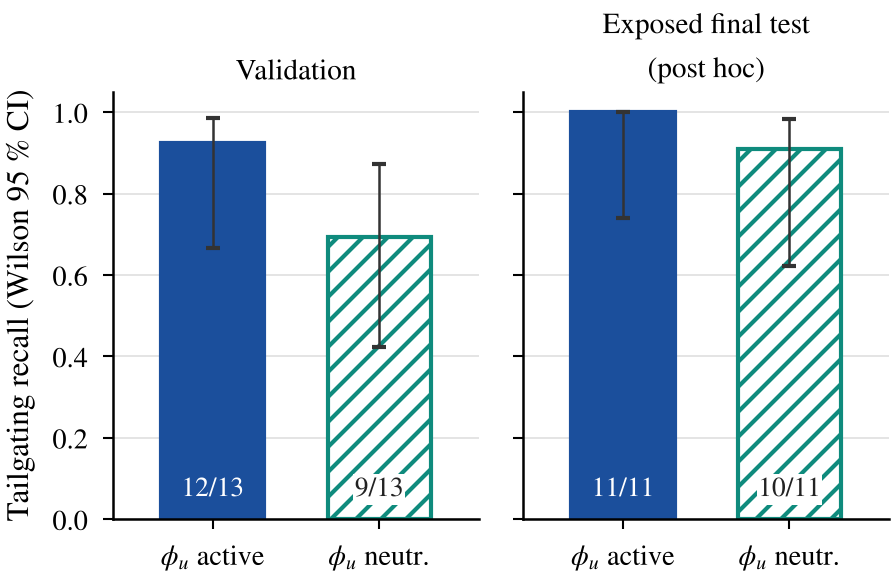

# Study 08: Dependence of the frozen detector on the tailgating summary feature φ_u

## At a glance

| | |
|---|---|
| **Research question** | How much does the frozen hybrid model depend on its one explicit physical summary, the tailgating fraction φu? |
| **What was compared** | The frozen DeepDAS Ensemble v1 with φu <b>active</b> (as trained and tested) against the same weights with φu <b>neutralized</b> (17th head input held at 0), using the frozen statistics and τ. |
| **Data** | The 9 development cases, the validation sets, and the final test. The final test had already been exposed, so its rows are <b>post hoc</b>. |
| **Result** | Development 7/9 vs 8/9 (only the tailgating case changes); validation tailgating 9/13 vs 12/13; final-test tailgating 10/11 vs 11/11; macro recall 0.560 vs 0.568. |
| **Conclusion and limits** | With φu active the frozen model detects one more development case. Most test tailgaters stay detected without it, so the learned representation carries most of their signal. This measures the dependence of the trained model, not the performance of a model trained without φu, which was never trained on the final data. |
| **Reproduce** | <code>python scripts/verify_phi_modes.py</code> (with the data package); tables: <code>code/make_tables.py</code>; figures: <code>code/make_figures.py</code>; report numbers: <code>code/number_sources.py</code>. |

Ensemble score of each development case with φu active (filled) and neutralized (open); dashed: the frozen τ. Only the tailgating case crosses.

Tailgating recall in the two options on validation and on the exposed final test (post hoc), with Wilson 95 % intervals and exact counts.

More figures: [figure gallery](../../figures/) · All studies: [research index](../)

---

## Full record

**Status:** post-hoc diagnostic analysis (2026-10-10). Nothing was trained, re-calibrated or re-standardised. The frozen checkpoints, thresholds and published results of DeepDAS Ensemble v1 are unchanged.

**One-sentence summary.** To measure how much the detector depends on the tailgating summary feature, we compared the frozen hybrid model with the same model when the feature is neutralized at inference. The comparison measures dependence on the feature, not the performance of a network trained without it.

## 1. The feature

**What it measures.** φ_u is the share of a unit's valid time bins in which there is a vehicle ahead, the time headway is below 0.8 s and the vehicle's own speed is above 5 m/s:

    φ_u = |{ b ∈ B_u : m_lead(b) > 0.5 ∧ t_h(b) < 0.8 s ∧ v_lon(b) > 5 m/s }| / |B_u|,   B_u = { b : m_valid(b) > 0 }

- B_u contains the 0.1 s bins of all usable tracks of the unit that are real, on-road and after the 1 s burn-in.
- t_h = gap / max(v_lon, 0.5 m/s), capped at 10 s.
- Computed after the duplicate-leader cleaning (a "leader" closer than 1 m at more than 5 m/s is a duplicate track).
- If B_u is empty, φ_u = 0. Bins with missing values do not satisfy the condition.
- Code: `src/deepdas/ensemble/detector.py::tailgating_fraction`.

**Data source.** φ_u is computed from the exported Kalman tracks: the leader is the nearest other track ahead in the same lane and time bin (`data/channels.py::leader_features`). No headway is read from the simulator's ground truth. All inputs share one caveat: the simulator's tracker uses truth during association and initialisation.

**How the head sees it.**
- The head receives x₁₇ = (φ_u − μ_φ)/σ_φ, with μ_φ = 0.005994 and σ_φ = 0.031635.
- These constants were fitted on the training normal vehicles and are stored in all five checkpoints, identically.
- x₁₇ is concatenated after the 16 standardised pooled code statistics. The trained head is 17 → 16 → 1.

**Relation to the encoder input.** Headway (`th_lead`) and the leader mask (`m_lead`) are already 2 of the 14 encoder input channels. φ_u adds no new measurement. It is an explicit track-level summary of information that the encoder receives window by window.

**Not "engineered vs. learned".** The 14 input channels are themselves precomputed physical quantities: lane-frame speed and acceleration, lateral offset, speed-limit ratio, gap, headway, closing speed, sensor masks and DAS amplitude. What this study varies is only the additional summary feature in the head.

## 2. Why it was introduced, and what the archived experiments show

**Why.** In study 02, the single model missed the tailgating and weaving development cases. Diagnosing the deep model suggested that the headway information was present in the input but not used: window codes pooled by mean and standard deviation do not directly expose "for what share of the track the headway is short". A physical summary of that quantity was therefore proposed (study 02, arm C). It was a design choice, not a feature discovered by the network, and the experiments do not show it to be the only possible remedy.

| Experiment (archived) | φ_u in head | Tailgating training data | Tailgating development case |
|---|---|---|---|
| Study 02, arm A, 3 seeds | no | early set (few, mostly unrealised) | not detected (0/3 seeds) |
| Study 02, arm C, 3 seeds | yes | early set | not detected (0/3 seeds); percentile among val_B normals rose from 85 to 94 |
| Study 03, C_old, 5 seeds | yes | early set | not detected (0/5); validation tailgating recall 0.385 |
| Study 03, C_new, 5 seeds | yes | expanded (59 verified tailgaters + matched controls) | detected by 5/5 seeds; validation tailgating recall 0.923 |
| — | no | expanded | **never trained** |

What these experiments support:
- **Early data:** adding the feature was not enough.
- **Expanded data:** with the feature already present, the expanded data improved detection.
- **Final data without the feature:** this combination was not trained.

It is therefore not correct to say that each change was tried alone and failed: one of the four combinations was never tested.

The hybrid model (φ_u active) is the candidate that was selected by the pre-registered rules of studies 03–04, frozen, and tested in the final test. This study does not change that history.

## 3. The two inference options (this release copy)

| Option | How to run | What it is |
|---|---|---|
| `active` (default) | `--phi-mode active` | The original hybrid model, exactly as trained, selected and tested. Reproduces the published tables byte for byte. |
| `neutralized` | `--phi-mode neutralized` | Inference-time intervention on the same frozen weights: x₁₇ := 0 in the standardised coordinate (the value of an average training-normal vehicle), via `Detector.head_in`. The 16 learned features are unchanged. Frozen μ_k, σ_k and τ = 1.9726 are used; nothing is re-estimated. Defined after the final test had been exposed. |

In `neutralized` mode:
- outputs go to `results_phi_neutralized/`;
- every CSV gets a `phi_mode` column, and every folder a `RUN_MODE.json`;
- Markdown reports get a banner.

The published `results/` folders carry a `RUN_MODE.json` saying `active`.

## 4. Results (tables in `tables/`, figures in `figures/`)

| Check | φ_u neutralized | φ_u active (hybrid) |
|---|---|---|
| Development cases (9, diagnostic) | 7/9 | 8/9 |
| Tailgating, validation (12 v3 + 1 cross-region) | 9/13 | 12/13 |
| Tailgating, exposed final test (post hoc) | 10/11 | 11/11 |
| Macro recall, exposed final test (post hoc, common subset) | 0.560 | 0.568 |

Other observations:
- **Development cases.** Only the tailgating case changes decision (score 3.73 → −0.08; its φ_u = 0.81, i.e. 25 σ above the training-normal mean). The other eight move by at most 0.034.
- **Validation.** Macro recall 0.714 → 0.688; false alarms on val_A normals 14 → 9 of 1,313; legitimate stops 40/54 in both; stalls 18/18 in both. The val_B alarm rate at the frozen τ is 1.05 % in both options, so the threshold stays meaningful.
- **Exposed final test (post hoc).**
  - Per type: speeding 4 → 3 of 12, collision 6 → 7 of 10, tailgating 11 → 10 of 11; all other types unchanged.
  - ROC-AUC 0.908 → 0.906, AUPRC 0.742 → 0.737.
  - False alarms: normal driving 20/1,008 in both; legitimate stops 20 → 19 of 28; tailgating matched controls 7/11 in both (their φ_u ≈ 0).

## 5. Conclusions the evidence supports, and limits

1. In the frozen model, the extra physical summary enabled the detection of one more development case: tailgating.
2. Most final-test tailgating cases (10/11) remained detected with the feature neutralized, and a linear probe on the 16-d pooled code separates them from normal tracks (study 06: AUC 1.0, cross-validated on exposed data, 11 positives). The learned representation carries most of the signal for tailgaters that resemble the expanded training data.
3. This does **not** show that the original tailgating improvement came from the feature alone, nor from the data alone (see §2).
4. The neutralized option is **not** an independent evaluation and **not** a model trained without the feature.
5. The final architecture is a hybrid: a learned convolutional encoder on physical input channels, plus one explicit physical summary feature in the head.

## 6. What a claim about a model trained without φ_u would require (not done)

- Retrain the final recipe with a 16-input head: same data, sampling, encoder initialisation, five seeds and pre-registered selection rule.
- Write the plan and the comparison metrics before training.
- Calibrate its own val_B statistics and P99 threshold.
- Evaluate on the validation sets only.
- The final test is exposed and cannot serve this comparison; an independent claim would need a new test set.

This requires explicit approval and was not started.

## Files

| Path | Content |
|---|---|
| `code/make_tables.py` | builds `tables/` from `results/` and `results_phi_neutralized/` |
| `code/make_figures.py` | figures G1–G4 (PNG, PDF, data CSV) |
| `code/number_sources.py` | maps every number in report v2 to model version, data role and source file, and checks it (`tables/REPORT_V2_NUMBER_SOURCES.csv/.md`) |
| `code/arch_figure.py` | architecture figure G0, asserted against the frozen checkpoints |
| `tables/` | development, validation, final-test (post-hoc) comparisons and the four-row summary |
| `figures/` | G0 architecture (neutralized inference), G1 development scores, G2 tailgating detection, G3 detection by type (four configurations), G4 ROC/PR (four configurations) |
